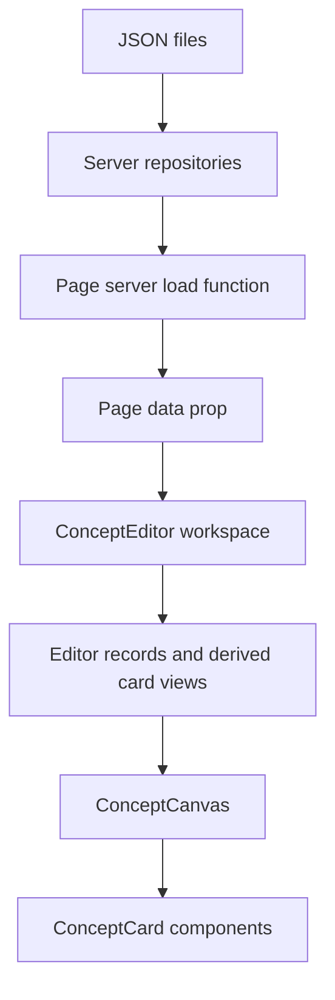
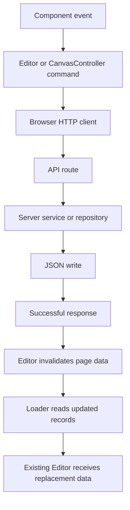

# 1. Application architecture

Concept Editor separates stored information, editor state, and visual components. A Concept records shared information about something. A ConceptInstance places that Concept in a context. The interface combines them to display a card.

This chapter maps those responsibilities. [Concepts and instances](02-concepts-and-instances.md) describes the records themselves; the later chapters follow their use in the editor.

## Source organization

| File or directory                                             | Responsibility                                                        |
| ------------------------------------------------------------- | --------------------------------------------------------------------- |
| `src/lib/model/`                                              | Data types, normalization, and relationship queries                   |
| `src/lib/server/repositories/`                                | Read and write the JSON files                                         |
| `src/lib/server/conceptService.ts`                            | Coordinate operations involving multiple records                      |
| `src/routes/api/`                                             | Receive HTTP requests and return responses                            |
| `src/routes/+page.server.ts`                                  | Load the records needed by the page                                   |
| `src/routes/+page.svelte`                                     | Pass page data into the workspace component                           |
| `src/lib/components/editor/ConceptEditor.svelte`              | Compose the workspace and provide one Editor                          |
| `src/lib/components/editor/Editor.svelte.ts`                  | Own client-side records, queries, navigation, selection, and commands |
| `src/lib/components/editor/canvas/CanvasController.svelte.ts` | Own spatial interactions and camera behavior                          |
| `src/lib/components/editor/canvas/ConceptCanvas.svelte`       | Render the current canvas                                             |
| `src/lib/components/editor/card/ConceptCard.svelte`           | Render one card and manage its local UI details                       |
| `src/lib/client/`                                             | Send browser requests to the API                                      |

These boundaries correspond to different jobs, not different kinds of information. The same Concept passes through several layers while it is loaded, displayed, and edited.

## Loading a page

The initial data path is:



`load()` in `src/routes/+page.server.ts` calls four repository functions:

- `getAllConcepts()`
- `getAllConceptInstances()`
- `getAllConceptRelationships()`
- `getAllRelationshipDefinitions()`

It returns their results as page data. It does not construct cards or decide how to display them.

`src/routes/+page.svelte` receives that data and passes it to the workspace:

```svelte
<script lang="ts">
	import ConceptEditor from '$lib/components/editor/ConceptEditor.svelte';
	import type { PageData } from './$types';

	let { data }: { data: PageData } = $props();
</script>

<main class="app">
	<ConceptEditor {data} />
</main>
```

`$props()` receives component inputs; `{data}` is shorthand for `data={data}`. The type annotation describes the input without changing the runtime object.

## Workspace, state, and rendering

`ConceptEditor.svelte` creates one `Editor` and makes it available to descendants through context. The Editor holds the loaded records and derives the card data used by the interface.

`ConceptCanvas.svelte` renders that derived collection:

```svelte
{#each editor.cardsInCurrentCanvas as card (card.instance.id)}
	<ConceptCard {card} />
{/each}
```

The instance ID is the rendering key because each placement needs its own component, even when several placements refer to the same Concept.

The workspace and canvas are separate components. The workspace includes the toolbar, sidebar, menus, and canvas viewport. The canvas component renders spatial content inside that viewport. `CanvasController` supplies the interaction behavior without owning the markup.

[Editor and context](04-editor-and-context.md) explains shared state. [Cards](06-cards.md) explains the relationship between a card's data and its rendered component.

## Editing and persistence

An edit travels in the other direction before refreshed records return:



For example, property editing uses an existing Concept update endpoint. A title edit instead uses a service because it may create a Concept and change an instance's reference together.

Camera saving is an exception to the final reload step: it writes the instance's camera fields without calling `invalidateAll()`. It does not need a complete page-data refresh for each save.

## Server and browser code

The server can access the JSON files through Node's file APIs. Browser components use HTTP clients instead of importing those repositories.

SvelteKit can also render components on the server. Therefore, creating the Editor must not depend on a browser DOM element. Element references and pointer handling become available when the interface is mounted in the browser.

This distinction matters for deployment as well as imports: the current application includes a Node server. A desktop package would still need a deliberate decision about how to run or replace that server and its persistence code.

## Exercise: document one data path

This is a source-tracing exercise; no application changes are required.

Starting with `getAllConceptInstances()`, record the files and symbols that take an instance from its JSON file to `<ConceptCard {card} />`. Include the point where the matching Concept is attached and the point where the current canvas filters the result.

Each step should correspond to a real function call, constructor argument, prop, or derived expression. There is no need to inspect pointer handlers for this trace.

[Worked trace](solutions/01-architecture.md)

## Verification and data safety

Reading source and running `npm run check` do not intentionally mutate the stored records. Creating, editing, dragging, resizing, and navigating can write JSON. In particular, leaving an instance-owned canvas saves its camera.

Use a disposable dataset for interaction tests. The [documentation index](README.md#data-safety) describes the backup requirements.

## Summary

The repositories persist records, the loader supplies them to the page, and the Editor derives the data used by components. Components display that data and dispatch actions. HTTP clients and server routes connect those actions back to persistence.

The same division recurs throughout the application: data describes the information, shared state coordinates the workspace, and components provide its visual interface.

[Concepts and instances](02-concepts-and-instances.md) · [Contents](README.md)
