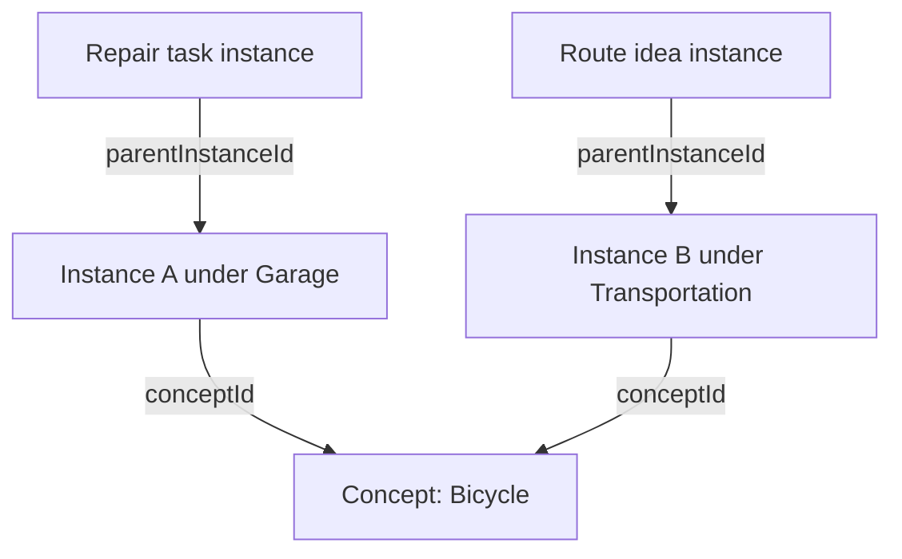

# 2. Concepts and instances

A Concept contains information shared across occurrences. A ConceptInstance records one placement of that Concept. Separating them allows the same thing to appear in several contexts without duplicating its properties or forcing those placements to share geometry and children.

## Source files

| File                                                       | Responsibility                                        |
| ---------------------------------------------------------- | ----------------------------------------------------- |
| `src/lib/model/Concept.ts`                                 | Define shared Concept data                            |
| `src/lib/model/ConceptInstance.ts`                         | Define a contextual placement                         |
| `src/lib/model/ConceptCardView.ts`                         | Define the pair used for display                      |
| `src/lib/model/normalizeConcept.ts`                        | Supply expected fields for loaded Concept data        |
| `src/lib/model/normalizeConceptInstance.ts`                | Supply expected placement and camera fields           |
| `src/lib/server/repositories/conceptInstanceRepository.ts` | Create, update, read, and save instances              |
| `src/lib/components/editor/Editor.svelte.ts`               | Join Concepts and instances and query their hierarchy |

## Concept

The persisted shape is:

```ts
export type Concept = {
	id: string;
	title: string;
	properties: Record<string, string>;
	tagConceptIds: string[];
};
```

- `id` identifies the Concept.
- `title` is its displayed name, not a unique key.
- `properties` contains string-valued metadata.
- `tagConceptIds` refers to other Concepts used as tags.

Two distinct Concepts may have the same title. Comparing names cannot establish whether two cards represent the same Concept; comparing their Concept IDs can.

A Concept has no containment parent. It can also exist without any instance. Shared property and tag edits affect the Concept, so all occurrences referencing it use the updated information.

These TypeScript definitions describe object shapes. Unlike Java classes, they do not supply constructors or runtime behavior.

## ConceptInstance

```ts
export type ConceptInstance = {
	id: string;
	conceptId: string;
	parentInstanceId: string | null;
	x: number;
	y: number;
	width: number;
	height: number;
	lastCameraPanX: number;
	lastCameraPanY: number;
	lastCameraZoom: number;
};
```

`conceptId` references the shared Concept. The instance's own ID identifies this particular placement.

`parentInstanceId` identifies one parent instance; `null` means root placement. Geometry belongs to the placement, not the shared Concept. The camera fields remember the view of this instance's child canvas, rather than its card's position in the parent canvas.

There is no local title, notes field, or child-ID array in this type.

### Independent occurrences

Suppose Bicycle appears under Garage and Transportation:



A and B share the Bicycle title, properties, and tags. They have different IDs and can have different positions, dimensions, cameras, and children.

Children refer to a **parent instance ID**. Consequently, adding a child under A does not automatically add it under B. Displaying A in another view also does not give it another containment parent.

[Trees and containment](08-trees-and-containment.md) develops this hierarchy in detail. Semantic connections between Concepts are a separate model, described in [Relationships](03-relationships.md).

## ConceptCardView

The UI often needs both records at once:

```ts
export type ConceptCardView = {
	instance: ConceptInstance;
	concept: Concept;
};
```

The Editor assembles this pair by looking up `instance.conceptId`. It is not another persisted entity and has no independent ID.

A card reads its title from `card.concept.title` and its position from `card.instance.x` and `card.instance.y`. The component receives the complete pair as its `card` prop. The [Cards chapter](06-cards.md) covers that component; [loading and derived cards](05-loading-and-derived-cards.md) covers how the pair is assembled.

## Creation inputs and loaded records

The repository's `CreateConceptInstanceInput` describes what callers can supply when creating a record. It requires `conceptId`, omits `id`, and allows geometry, parentage, and camera values to be omitted. `createConceptInstance()` generates the ID and supplies defaults before saving a complete instance.

`normalizeConceptInstance()` does a different job: it supplies missing fields when data is read or passed into the Editor. Its job is to make input usable in memory, not to create a new placement.

The related repository types describe other operations:

| Type                         | Meaning                                          |
| ---------------------------- | ------------------------------------------------ |
| `ConceptInstance`            | A complete record                                |
| `CreateConceptInstanceInput` | Accepted fields for a new record                 |
| `UpdateConceptInstanceInput` | Optional changes, excluding `id` and `conceptId` |
| `ConceptInstanceBatchUpdate` | An instance ID paired with those changes         |

These are different contracts around the same information. They are not additional stored entities. Title reassignment can change `conceptId` through the coordinated title service rather than this general update type.

One existing discrepancy remains: normalization defaults missing camera zoom to `0`, while creation defaults it to `1`. The tutorial does not change that behavior.

## Identity during editing

Editing a named occurrence's title can change which Concept it references. It does not generally rename the existing shared Concept.

If A changes from Bicycle to Scooter, A retains its instance ID, placement, camera, and children. B can continue referring to the original Bicycle Concept. The service has a special case for naming a blank Concept with only one instance.

[Creation and title editing](10-creation-and-title-editing.md) traces those decisions and the unfinished conflict-selection UI.

## Exercise: display occurrence counts

In `ConceptCard.svelte`, add a derived count of all card views whose Concept ID matches the current card's Concept ID. Display it inside `card-sidebar`, before `ConceptTagsPreview`.

Requirements:

- Use `editor.cards`, not only `editor.cardsInCurrentCanvas`.
- Compare Concept IDs, not titles.
- Derive the count; do not add a persisted field or API request.
- Show `1 occurrence` or the appropriate plural.

The count includes occurrences throughout the loaded workspace. It remains separate from the number of children under this particular instance.

Run `npm run check`. Optional visual inspection can use already visible, expanded cards without creating or moving records. The label is inside the body, so the current size-based collapse hides it on small cards. Do not resize live cards just to test it.

Remove the derived declaration and label to undo the exercise, or retain them for later chapters. No data rollback is needed for the display change itself.

[Solution](solutions/02-concepts-and-instances.md)

## Summary

A Concept identifies shared information; an instance identifies one contextual placement. Shared metadata belongs to the Concept, while parentage, geometry, camera, and children are instance-specific. A `ConceptCardView` combines the two records for display without adding another source of truth.

[Relationships](03-relationships.md) · [Contents](README.md)
