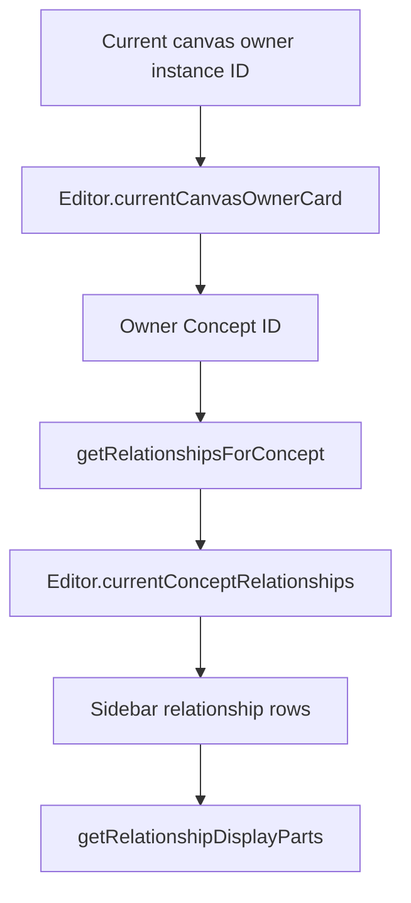

# 3. Relationships

Containment records where an instance is placed. A semantic relationship records a connection between Concepts or between relationships. They are separate structures: moving an instance changes its `parentInstanceId`, not its semantic relationships.

This chapter covers the relationship model, query functions, and current sidebar display. The exercise adds a derived count; it does not create or edit relationship records and requires no other tutorial exercise.

## Responsibilities and main functions

| File under `src/`                                          | Responsibility                                                                    |
| ---------------------------------------------------------- | --------------------------------------------------------------------------------- |
| `lib/model/ConceptRelationship.ts`                         | Defines relationship occurrences, participant groups, and participant references. |
| `lib/model/RelationshipDefinition.ts`                      | Defines optional display and inverse/mutual metadata for a relationship kind.     |
| `lib/model/relationshipQueries.ts`                         | Selects connected records and converts one record into display parts.             |
| `lib/components/editor/Editor.svelte.ts`                   | Derives `currentConceptRelationships` for the current canvas owner's Concept.     |
| `lib/components/editor/sidebar/ConceptSidebar.svelte`      | Renders the selected records.                                                     |
| `lib/server/repositories/conceptRelationshipRepository.ts` | Reads and writes relationship records.                                            |
| `routes/api/relationships/+server.ts`                      | Exposes GET, POST, PATCH, and DELETE handlers.                                    |

Start with the exported functions in `relationshipQueries.ts`:

- `getRelationshipsContainingConcept(relationships, conceptId)` selects records containing a direct `'concept'` participant with that ID.
- `getRepresentedRelationship(relationships, conceptId)` returns the **first** record represented by that Concept, or `undefined`.
- `getRelationshipsForConcept(relationships, conceptId)` combines direct participation with that represented record, avoiding a duplicate by relationship ID.
- `getRelationshipDisplayParts(relationship, definitions, currentConceptId, getConceptById)` produces text and Concept parts for the sidebar.

Selection and formatting answer different questions. The first determines which records belong in the section; the second determines which parts of a record can be displayed from the current Concept's perspective.

## Relationship occurrences and participants

The complete stored relationship types are:

```ts
export type RelationshipParticipantReference =
	{ type: 'concept'; id: string } | { type: 'relationship'; id: string };

export type RelationshipParticipantGroup = {
	participants: RelationshipParticipantReference[];
};

export type ConceptRelationship = {
	id: string;
	relationshipConceptId: string;
	participantGroups: RelationshipParticipantGroup[];
	representedByConceptId?: string;
	properties: Record<string, string>;
};
```

A relationship is an occurrence with its own ID. It is not a `ConceptInstance`: it has no containment parent, geometry, or camera fields.

| Field                    | Meaning                                                                          |
| ------------------------ | -------------------------------------------------------------------------------- |
| `id`                     | Identifies this particular relationship occurrence.                              |
| `relationshipConceptId`  | Identifies the Concept describing the relationship **kind**.                     |
| `participantGroups`      | Ordered positions, each containing zero or more typed references.                |
| `representedByConceptId` | Optionally identifies a Concept representing this particular occurrence.         |
| `properties`             | String-valued metadata on the relationship itself, not on a participant Concept. |

A `'concept'` reference identifies a reusable Concept, not one of its spatial instances. A `'relationship'` reference identifies another `ConceptRelationship` record. The discriminator is necessary: an ID alone does not specify which collection to search. There is no `'instance'` participant variant.

For example, suppose the Concepts include `employee-of`, `alex`, `acme`, `alex-employment`, `documented-by`, and `contract`:

```ts
const employment: ConceptRelationship = {
	id: 'employment-1',
	relationshipConceptId: 'employee-of',
	participantGroups: [
		{ participants: [{ type: 'concept', id: 'alex' }] },
		{ participants: [{ type: 'concept', id: 'acme' }] }
	],
	representedByConceptId: 'alex-employment',
	properties: { since: '2024' }
};

const documentation: ConceptRelationship = {
	id: 'documentation-1',
	relationshipConceptId: 'documented-by',
	participantGroups: [
		{ participants: [{ type: 'relationship', id: 'employment-1' }] },
		{ participants: [{ type: 'concept', id: 'contract' }] }
	],
	properties: {}
};
```

`employee-of` is the kind, `employment-1` is the occurrence, and `alex-employment` is its optional representing Concept. The documentation record refers to the occurrence directly; using `{ type: 'concept', id: 'alex-employment' }` would instead refer to its representing Concept. These are distinct references, not interchangeable aliases in current queries.

The examples describe the model only. Do not insert them into the project's real JSON files.

### RelationshipDefinition

A definition attaches optional behavior and display metadata to a relationship-kind Concept:

```ts
export type RelationshipDefinition = {
	conceptId: string;
	inverseConceptId?: string;
	isMutual?: boolean;
	forwardPattern?: string;
	inversePattern?: string;
};
```

- `conceptId` matches the occurrence's `relationshipConceptId`.
- `inverseConceptId` can identify an inverse kind. Current display helpers do not use it to find or generate inverse records.
- `isMutual` selects mutual display behavior; it does not merge records or establish query equivalence.
- `forwardPattern` and `inversePattern` contain text and numbered participant-group placeholders.

For the employment example:

```ts
const definition: RelationshipDefinition = {
	conceptId: 'employee-of',
	inverseConceptId: 'employer-of',
	isMutual: false,
	forwardPattern: '[0] employee of [1]',
	inversePattern: '[1] employer of [0]'
};
```

From Alex's perspective the formatter omits group 0, yielding `employee of Acme`. From Acme's perspective it uses the inverse pattern and omits group 1, yielding `employer of Alex`. The current Concept is supplied by the surrounding sidebar, so it is not repeated in the sentence.

For mutual definitions, the current group is moved to display position 0 and the forward pattern is used. Numbered placeholders such as `[0]` are supported; `[all]` is **not**, despite an older example comment in `ConceptRelationship.ts`.

## From an open canvas to relationship rows

Opening an instance identifies its owner Concept. Relationships are then queried by that Concept ID, not by the instance ID or its parent.



For an instance of Alex:

1. `currentCanvasOwnerCard` resolves the instance's card view.
2. `currentConceptRelationships` queries `getRelationshipsForConcept` with Alex's Concept ID.
3. `employment-1` is selected because Alex is a direct Concept participant.
4. The sidebar's `relationships` derived value follows that result.
5. Each row passes the record, definitions, current Concept ID, and Concept lookup callback to the formatter.
6. Text parts render as text; Concept parts render titles, with `Untitled Concept` as the empty-title fallback.

At root there is no owner Concept, so the derived array is empty and the Concept relationship section is not rendered. Two instances of Alex query the same semantic records even if their children and positions differ.

After this public path, the formatter's private helpers explain the mechanics: `getCurrentParticipantGroupIndex` locates the current Concept; `getRelationshipDefinition` and `getRelationshipPattern` select a definition and direction; `getDisplayGroupIndexes` handles mutual ordering; `cleanRelationshipDisplayParts` normalizes whitespace.

## Current limits

The model is more expressive than the current queries and UI:

- Direct-participation queries do not recursively follow `'relationship'` references or treat representing Concepts as equivalent to the represented occurrences.
- Only the first represented relationship is added by `getRepresentedRelationship`; the stored type does not itself enforce uniqueness.
- The formatter requires a definition with a truthy `forwardPattern` and the current Concept as a direct Concept participant. An inverse pattern alone is insufficient.
- A record selected only through `representedByConceptId` can therefore produce no display parts. Its sidebar row still exists.
- The formatter skips relationship-type participants and unresolved Concept IDs. Multiple participants in a group are emitted without automatically inserted conjunctions.
- Repository/API operations do not establish complete authoring UI, participant navigation, equivalence-aware queries, or spatial connectors. Sidebar participant titles are spans, not navigation controls.

## Exercise: count selected relationships

Change only `src/lib/components/editor/sidebar/ConceptSidebar.svelte`. Make the existing heading show `Relationships (N)`, where `N` is the length of the existing derived `relationships` array.

Requirements:

1. Keep the existing query and row iteration unchanged.
2. Add no state, imports, helpers, persisted fields, or CSS.
3. Count selected records, including any represented-only record with an empty display row.
4. Do not depend on a metadata summary or any later chapter's changes.

Expected cases are `Relationships (0)`, `Relationships (1)`, and `Relationships (3)` for arrays of those lengths. Root must still omit the section. See the [separate solution](solutions/03-relationships.md) after implementing the change.

## Verification and cleanup

Run `npm run check` and `npm run build` from the project root after the exercise. These check compilation, not browser behavior.

For browser checks, use a disposable project copy with isolated JSON files and run the app from that copy's root. Navigation can save instance cameras even though the heading itself is read-only. Do not create relationships in live data to obtain particular counts.

Check existing examples: the count must equal the number of `.sidebar-relationship-row` elements, including empty rows, and update when opening a different owner Concept. No selected records must show the existing `No relationships yet.` message. The relationship file hash (`sha256sum src/lib/data/concept_relationships.json`) should remain unchanged before and after these checks.

To undo the exercise, restore only the heading to literal `Relationships`. No relationship data rollback is needed for the display change.

## Summary

Relationships connect reusable Concept or relationship identities; containment places instances. A definition controls limited display behavior, not the meaning or completeness of every query. The sidebar renders a derived selection whose record count can exceed the number of readable descriptions.

- [Concepts and instances](02-concepts-and-instances.md)
- [Editor and context](04-editor-and-context.md)
- [Exercise solution](solutions/03-relationships.md)
