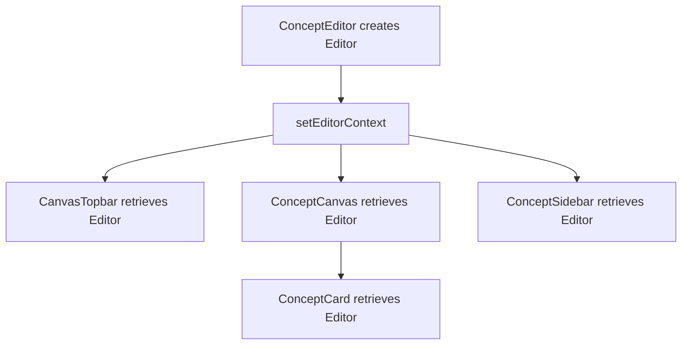

# 4. Editor and context

The `Editor` is the shared state object for one workspace. Components use it to query records, select instances, navigate, and issue commands. Svelte context makes that same object available throughout the component subtree without forwarding every operation through intermediate props.

The Editor is separate from `ConceptEditor.svelte`: the class coordinates state and commands; the component composes the workspace and connects it to page data and DOM events.

## Source files and main operations

| File                                                   | Responsibility and main operations                                                          |
| ------------------------------------------------------ | ------------------------------------------------------------------------------------------- |
| `src/lib/components/editor/Editor.svelte.ts`           | Construct the controller, receive records with `replaceData()`, expose queries and commands |
| `src/lib/components/editor/EditorContext.ts`           | Define `getEditorContext()` and `setEditorContext()`                                        |
| `src/lib/components/editor/ConceptEditor.svelte`       | Construct/provide the Editor, bridge refreshed data, bind the viewport, resize the sidebar  |
| `src/lib/components/editor/canvas/CanvasTopbar.svelte` | Retrieve the Editor and invoke commands from controls                                       |
| `src/lib/components/editor/EditorTypes.ts`             | Describe page records, command options, and shared UI types                                 |

The Editor constructor creates one `CanvasController` and calls `replaceData(data)`. It does not attach browser listeners or access a DOM element.

## Records, derived values, and UI state

The class contains three different kinds of state:

| Kind           | Examples                                                                  | Purpose                                                       |
| -------------- | ------------------------------------------------------------------------- | ------------------------------------------------------------- |
| Loaded records | `concepts`, `instances`, `relationships`, `relationshipDefinitions`       | Client-side working data supplied by the server               |
| Derived values | `cards`, `cardsByInstanceId`, `cardsInCurrentCanvas`, `currentBreadcrumb` | Indexes and views calculated from records and current context |
| UI state       | `selectedInstanceIds`, `activeInstanceId`, `sidebarVisible`, `mainView`   | Current interaction and presentation choices                  |

Fields declared with `$state` are reactive. Fields declared with `$derived` or `$derived.by` are calculated from reactive dependencies.

```ts
sidebarVisible = $state(true);
```

When a command changes this field, markup reading `editor.sidebarVisible` can update. Context itself is not responsible for detecting the change; the reactive field is.

Loaded records ultimately come from persistence. Selection and visibility are not persisted just because they are in the same class.

### Collections

Ordinary `Set` and `Map` mutations do not become observable merely because the collection is stored in `$state`. Replacing a collection is one way to signal a change; Svelte reactive collections are another. The existing code uses replacement-based selection updates and also uses `SvelteSet` in a selection path.

The distinction matters when adding commands: mutating an ordinary Set in place is not equivalent to assigning a new Set.

## Providing and retrieving the Editor

`EditorContext.ts` defines a typed context pair:

```ts
export const [getEditorContext, setEditorContext] = createContext<Editor>();
```

`ConceptEditor.svelte` constructs and provides the object during component initialization:

```ts
const editor = untrack(() => new Editor(data));
setEditorContext(editor);
```

Descendant components retrieve it in their scripts:

```ts
const editor = getEditorContext();
```



The context helper does not contain a module-global Editor. The supplied value belongs to this provider's subtree. Separate workspace providers could supply separate Editors; that is an architectural property, not an implemented multiple-workspace feature.

Components still receive props for their own identity and per-use behavior. For example, a card receives a `ConceptCardView`, while a tree may receive optional child-drag callbacks.

## Stable Editor, refreshed records

After a mutation reloads page data, `ConceptEditor.svelte` calls `editor.replaceData(...)` rather than constructing a new Editor.

This preserves the object already held by context consumers. It also keeps record refresh separate from choices such as the current canvas and sidebar state. Creating a replacement Editor on every load would reset its fields; never forwarding new data would leave the original Editor stale.

`untrack()` excludes the reads inside its callback from surrounding dependency tracking. The refreshed-data effect deliberately tracks incoming `data` fields and performs record replacement inside `untrack()`. [Loading and derived cards](05-loading-and-derived-cards.md) shows the full effect.

## Local component state

Not every value belongs in the Editor:

- `ConceptEditor.svelte` owns the sidebar resize gesture and DOM references.
- `ConceptCard.svelte` owns its title input reference and child-hold timer.
- Tree components own their expansion state.
- The sidebar owns property and tag drafts.

Those details serve individual component instances. The Editor owns state that coordinates the workspace. A title input reference is local; the request to focus a newly created instance is shared through `pendingFocusInstanceId`.

## Trace: switching to Table

1. `CanvasTopbar` retrieves the Editor from context.
2. Its Table button calls `editor.setMainView('table')`.
3. The command sets `mainView` and switches the sidebar tab to Tree.
4. `ConceptEditor.svelte` reads `editor.mainView` in its conditional markup.
5. The workspace shows the existing table placeholder instead of `ConceptCanvas`.

The placeholder is the current implementation; this path does not provide a working table. No intermediate component forwards a `setMainView` callback, and no server request is needed for the switch.

## Exercise: add a sidebar visibility command

Add `toggleSidebar()` to the Editor and a topbar button that calls it.

- The command should invert `sidebarVisible`.
- The button should say `Hide Sidebar` when visible and `Show Sidebar` when hidden.
- Wrap the call in an arrow callback so the method retains its receiver.
- Do not add persistence or mutate the field directly in the button.

Run `npm run check`. Clicking the button should hide and restore the sidebar; reloading should restore the default visible state. These visibility changes do not write records. Other canvas interactions can, so they are not needed for this test.

Remove the command and button to undo the exercise. The [solution](solutions/04-editor-and-context.md) can also be kept alongside the later topbar exercises.

## Summary

The Editor coordinates one workspace. Context gives descendants access to that stable object; Svelte reactivity updates their markup when observed fields change. Records, derived views, shared UI state, and component-local details have different responsibilities even when they participate in the same action.

[Loading and derived cards](05-loading-and-derived-cards.md) · [Contents](README.md)
