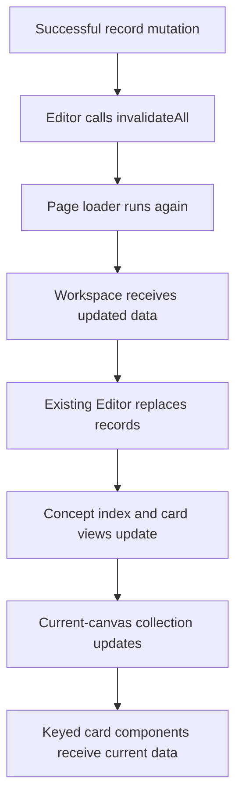

# 5. Loading and derived cards

The application persists Concepts and instances separately, then joins them for display. The loader supplies records; the Editor derives card views and filters them for the current canvas. Refreshed records return through the same path without replacing the Editor itself.

## Source files and main functions

| File                                                       | Responsibility                                                           |
| ---------------------------------------------------------- | ------------------------------------------------------------------------ |
| `src/lib/server/repositories/conceptRepository.ts`         | `getAllConcepts()` reads and normalizes Concepts                         |
| `src/lib/server/repositories/conceptInstanceRepository.ts` | `getAllConceptInstances()` reads and normalizes placements               |
| `src/lib/model/normalizeConcept.ts`                        | Default missing Concept fields                                           |
| `src/lib/model/normalizeConceptInstance.ts`                | Default missing instance fields                                          |
| `src/routes/+page.server.ts`                               | `load()` gathers four record collections                                 |
| `src/lib/components/editor/ConceptEditor.svelte`           | Forward page data to the stable Editor                                   |
| `src/lib/components/editor/Editor.svelte.ts`               | `replaceData()` receives records; derived fields build indexes and cards |
| `src/lib/components/editor/canvas/ConceptCanvas.svelte`    | Render the current-canvas collection                                     |

## Reading and normalizing records

The instance repository's read function is:

```ts
export async function getAllConceptInstances(): Promise<ConceptInstance[]> {
	const file = await readFile(instancesPath, 'utf8');
	const rawInstances = JSON.parse(file) as Partial<ConceptInstance>[];

	return rawInstances.map((instance, index) => normalizeConceptInstance(instance, index));
}
```

`readFile()` returns text. `JSON.parse()` produces JavaScript values. The TypeScript assertion describes those values to the checker; it does not validate the file at runtime. Normalization supplies missing fields according to the model's defaults.

For example, `normalizeConcept()` defaults absent properties to an empty object and absent or non-array tag IDs to an empty array. These functions are not complete schema validators. They also do not save the normalized result merely because it was read.

Creation is a different operation: it generates a new ID and applies defaults to accepted creation input. The distinction is covered in [Concepts and instances](02-concepts-and-instances.md#creation-inputs-and-loaded-records).

## Loading the workspace

`load()` gathers Concepts, instances, relationships, and relationship definitions. The page passes them as `data` to `ConceptEditor.svelte`.

The workspace creates an Editor once, then forwards incoming records when page data changes:

```ts
$effect(() => {
	const concepts = data.concepts;
	const instances = data.instances;
	const relationships = data.relationships;
	const relationshipDefinitions = data.relationshipDefinitions;

	untrack(() => {
		editor.replaceData({ concepts, instances, relationships, relationshipDefinitions });
	});
});
```

The effect tracks the incoming collections. Its untracked callback keeps reads made during replacement from becoming additional dependencies.

`replaceData()` assigns the arrays to reactive fields, normalizing Concepts and instances at the Editor boundary as well. Context consumers retain the same Editor reference. The records inside it are replaceable.

## Joining Concepts to instances

The Editor first derives a lookup index:

```ts
conceptsById = $derived.by(() => {
	return new Map(this.concepts.map((concept) => [concept.id, concept]));
});
```

It then uses each instance's reference to find its Concept:

```ts
cards = $derived.by((): ConceptCardView[] => {
	return this.instances.flatMap((instance) => {
		const concept = this.conceptsById.get(instance.conceptId);
		return concept ? [{ concept, instance }] : [];
	});
});
```

`flatMap()` contributes one pair when the Concept exists and no pair when it does not. A missing Concept reference is therefore omitted from the card collection, not automatically repaired or deleted from storage.

`cardsByInstanceId` indexes those pairs for direct lookup. `getCard(instanceId)` uses that index. These are supporting queries built on the same records, not separately persisted copies.

## Selecting the current canvas

```ts
cardsInCurrentCanvas = $derived(
	this.cards.filter((card) => card.instance.parentInstanceId === this.currentCanvasOwnerInstanceId)
);
```

At root, the owner ID is `null`, so instances with a null parent are visible. In an instance-owned canvas, its immediate children are visible.

- `editor.cards` contains all valid Concept/instance pairs in the loaded workspace.
- `editor.cardsInCurrentCanvas` contains only the direct placements in the current context.

This is the same distinction used by the occurrence-count exercise: global occurrences are counted from all cards, whereas a canvas summary uses only currently placed cards.

## Refresh after a mutation



The derived chain removes the need to manually synchronize embedded copies of Concept data in every card. It does not remove the need to fetch persisted changes: that is why the invalidation and incoming-data bridge both matter.

Camera persistence deliberately skips this full reload. [Navigation and cameras](09-navigation-and-cameras.md) explains that exception.

## Exercise: display a canvas summary

In `CanvasTopbar.svelte`, derive and display two counts from `editor.cardsInCurrentCanvas`:

- Number of placements.
- Number of distinct Concept IDs.

Place the summary after the existing owner-title conditional inside `concept-topbar-title`. Use `1 placement / 1 concept` and appropriate plurals. No schema field, endpoint, or Editor method is needed.

These examples define the behavior; they are hypothetical data, not instructions to modify the live dataset:

| Visible placements                       | Summary                     |
| ---------------------------------------- | --------------------------- |
| None                                     | `0 placements / 0 concepts` |
| One occurrence                           | `1 placement / 1 concept`   |
| Two occurrences of the same Concept      | `2 placements / 1 concept`  |
| Two different Concepts with equal titles | `2 placements / 2 concepts` |

A Set of Concept IDs gives the distinct count. A Set of titles would incorrectly combine different same-title Concepts.

Run `npm run check`. Optional observation of the initially loaded canvas is sufficient; do not create, move, or navigate to manufacture test cases against live data. The summary itself does not write records.

Remove its derived declarations and markup to undo the exercise, or retain them with other topbar additions.

[Solution](solutions/05-loading-and-derived-cards.md)

## Summary

Repositories read records, normalization supplies expected fields, and the loader passes the collections to a stable Editor. The Editor derives card views by ID and filters them by parent instance. A normal record mutation reloads the records through this same chain; the components update from the derived results.

[Cards](06-cards.md) · [Contents](README.md)
