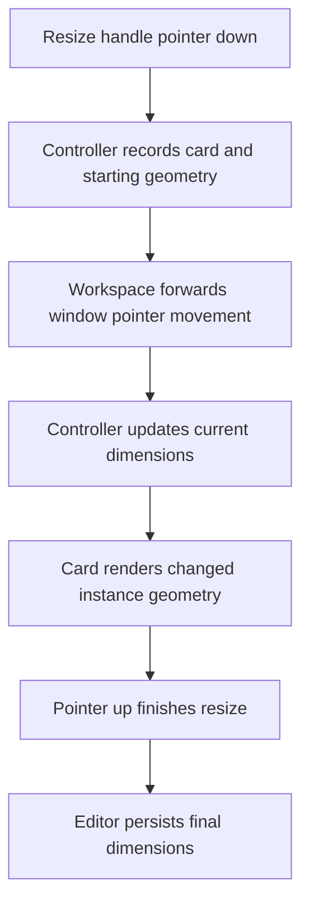

# 6. Cards

A card is the visual interface for one ConceptInstance and the Concept it references. It displays shared information using the placement's geometry and dispatches interaction events to the editor's controllers.

There are two similarly named pieces:

- `ConceptCardView` is the data pair `{ concept, instance }`.
- `ConceptCard.svelte` is the component that renders that pair.

The component does have access to all of the pair's data. Keeping the data separate makes it available to the sidebar and tree without requiring a rendered card.

## Source files and responsibilities

| File                                                          | Responsibility                                                       |
| ------------------------------------------------------------- | -------------------------------------------------------------------- |
| `src/lib/model/ConceptCardView.ts`                            | Define the paired data shape                                         |
| `src/lib/components/editor/card/ConceptCard.svelte`           | Render the card, focus its title, and manage its child-hold timer    |
| `src/lib/components/editor/card/ConceptDropArea.svelte`       | Render the child area and handle blank-area opening                  |
| `src/lib/components/editor/ConceptTagsPreview.svelte`         | Display tags and collect tag-entry interaction                       |
| `src/lib/components/editor/canvas/CanvasController.svelte.ts` | Handle card pointer events, resize, title events, and child dragging |
| `src/lib/components/editor/Editor.svelte.ts`                  | Supply selection state, records, commands, and focus requests        |

## Receiving the card data

The component receives a prop and retrieves the shared Editor separately:

```ts
let { card }: { card: ConceptCardView } = $props();

const editor = getEditorContext();

let concept = $derived(card.concept);
let instance = $derived(card.instance);
```

The prop identifies this card. Context supplies capabilities shared by the workspace. The derived names are reactive references to the two parts, not independent data copies.

The title input reads `concept.title`. Position and size read `instance.x`, `instance.y`, `instance.width`, and `instance.height`. This follows the [model's ownership rules](02-concepts-and-instances.md): shared information comes from the Concept, placement comes from the instance.

`ConceptCanvas` keys its card loop by instance ID. Several occurrences of one Concept therefore remain distinct visual components.

## Main interaction paths

Most events are dispatched rather than implemented inside the card:

| Element or event           | Target                                                 |
| -------------------------- | ------------------------------------------------------ |
| Card pointer down          | `editor.canvas.handleCardPointerDown(event, card)`     |
| Card context menu          | `editor.canvas.handleCardContextMenu(event, card)`     |
| Resize handle pointer down | `editor.canvas.handleResizePointerDown(event, card)`   |
| Title keydown              | `editor.canvas.handleConceptTitleKeydown(event, card)` |
| Title blur                 | `editor.canvas.handleConceptTitleBlur(event, card)`    |
| Manual tag entry           | `editor.addTag(card, title)`                           |
| Tag removal                | `editor.removeTag(card, tagConcept)`                   |

The callback wrappers preserve the receiver of controller and Editor methods. They also supply this card's identity.

### Trace: pressing the resize handle



The card provides the handle and displays geometry. The controller owns the gesture; the Editor and client/server path persist its result. [Canvas](07-canvas.md) explains the spatial calculations.

## Title focus

The component owns a `titleInput` element reference. The Editor owns `pendingFocusInstanceId`, which requests focus for a specific placement after an action such as creation.

A local effect checks whether the request matches this instance and the input exists. It then focuses and selects the title text, and clears the matching request.

This separates a workspace-level intention from a component-level DOM operation. The Editor does not need to hold every card's input element.

The input's `value` comes from the Concept, but committing an edit is not a direct global rename. The title handlers pass the instance context through to the service described in [creation and title editing](10-creation-and-title-editing.md).

## Child hold-to-drag

`handleChildTilePointerDown()` and `cancelChildTileHold()` support a short delay before child dragging:

1. Ignore non-primary buttons and pointer events on controls.
2. Retain the candidate child card and start a 300 ms timer.
3. If the timer completes, call `editor.canvas.startChildDrag(event, childCard)`.
4. Cancel the pending timer on the supplied release/cancel paths and on component destruction.

The timer belongs to this card component because it represents a pending local gesture. Once dragging starts, the controller coordinates movement and drop targets across the canvas.

The historical `child-tile` names remain in active handlers and DOM classes. They do not mean the old measured child-tile layout is still in use. [Trees and containment](08-trees-and-containment.md) follows the current recursive child display.

## Derived presentation state

The card derives selection, active, drag, arrangement, and marquee-preview flags from shared state. It does not maintain a second independent selection list.

Its body is currently hidden when `instance.width <= 190` or `instance.height <= 80`. This is a simple size threshold, not the planned configurable detail system. Notes and interactive hover previews remain future features.

CSS is otherwise outside this guide's scope, but interaction selectors are significant. Classes and instance/concept data attributes used by drop detection must remain consistent with the controller.

## Exercise: display the two identities

Add a read-only label immediately after the title input:

```text
Concept ID: … · Instance ID: …
```

Requirements:

- Read the values from `concept.id` and `instance.id`.
- Label both values explicitly and use `<code>` for the IDs.
- Do not add editable inputs, persisted fields, or duplicate local state.
- Leave the existing title, card, and resize event handlers unchanged.

This can coexist with the occurrence-count label from the [Concepts chapter](02-concepts-and-instances.md#exercise-display-occurrence-counts).

Run `npm run check`. Inspect the existing canvas if desired: occurrences of one Concept share the Concept ID but have different instance IDs. Do not perform title edits, dragging, resizing, or navigation against live data for this display-only test; inspect their event wiring in source instead.

Remove the label to undo the exercise. No data rollback is needed unless separate mutating interactions were performed.

[Solution](solutions/06-cards.md)

## Summary

`ConceptCardView` contains the records; `ConceptCard.svelte` displays them. The component owns DOM-local details such as title focus and a pending hold timer. Shared selection, spatial gestures, and persisted commands remain with the Editor and CanvasController.

[Canvas](07-canvas.md) · [Contents](README.md)
