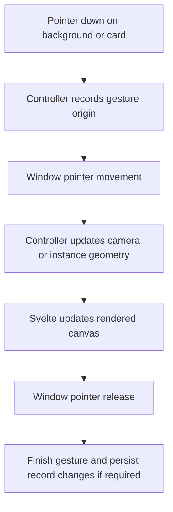

# 7. Canvas

[Cards](06-cards.md) · [Worked solution](solutions/07-canvas.md) · [Trees and containment](08-trees-and-containment.md)

## Scope

The canvas renders instance geometry through a camera and translates browser gestures into spatial operations. Moving the camera changes the view; moving or resizing a card changes an instance. Keeping those operations separate prevents a view command from accidentally becoming a record mutation.

The relevant background is [Editor and context](04-editor-and-context.md) and [Loading and derived cards](05-loading-and-derived-cards.md). The optional Reset View exercise below requires no earlier exercise changes.

## Source responsibilities

Paths in this chapter are relative to the project root.

| Source                                                        | Responsibility and main operations                                                                           |
| ------------------------------------------------------------- | ------------------------------------------------------------------------------------------------------------ |
| `src/lib/components/editor/canvas/CanvasController.svelte.ts` | Owns reactive camera and gesture state; handles wheel, pointer, keyboard, framing, and arrangement commands. |
| `src/lib/components/editor/canvas/ConceptCanvas.svelte`       | Renders visible cards, the world transform, marquee, child-drag ghost, and zoom indicator.                   |
| `src/lib/components/editor/ConceptEditor.svelte`              | Creates the workspace Editor, provides context, binds the canvas element, and forwards window events.        |
| `src/lib/components/editor/canvas/CanvasTopbar.svelte`        | Calls view commands through `editor.canvas` and navigation commands through `editor`.                        |
| `src/lib/components/editor/Editor.svelte.ts`                  | Owns canonical records, selection, visible-card queries, mutations, and navigation sequencing.               |

Start with the controller's public operations:

- `handleCanvasWheel` changes zoom around the pointer.
- `handleCanvasPointerDown` starts panning or marquee selection on the background.
- `handleCardPointerDown` establishes selection and a pending card drag.
- `handleWindowPointerMove` dispatches movement to the active gesture.
- `handleWindowPointerUp` finishes the gesture and persists record changes where appropriate.
- `frameCardsInCurrentCanvas` and `focusSelectionOrNearestCard` change the camera.
- `arrangeCardsInCurrentCanvasInGrid` changes card positions and persists them.

Supporting types live in `canvas/CanvasTypes.ts`. Pure rectangle calculations live in `canvas/geometry.ts`; sizing and packing calculations live in `canvas/layout.ts`. These helpers calculate values rather than owning a workspace or installing event listeners.

## World, canvas, and browser coordinates

Instance `x` and `y` are world coordinates. They remain the same when the user pans or zooms. A canvas point is measured in pixels relative to the canvas viewport; an event's `clientX` and `clientY` are relative to the browser viewport.

`getCanvasPointFromPointerEvent` subtracts the canvas rectangle's `left` and `top` from the client coordinates. `canvasPointToWorldPoint` then reverses the camera:

```ts
canvasPointToWorldPoint(point: { x: number; y: number }) {
	return {
		x: (point.x - this.panX) / this.zoom,
		y: (point.y - this.panY) / this.zoom
	};
}
```

`getWorldPointFromEvent` composes those two conversions. Creation and drop placement can therefore use world coordinates even when the canvas is panned or scaled.

The forward and inverse relationships are:

```text
canvasX = worldX * zoom + panX
canvasY = worldY * zoom + panY

worldX = (canvasX - panX) / zoom
worldY = (canvasY - panY) / zoom
```

For example, world point `(100, 50)` with zoom `2` and pan `(30, 10)` appears at canvas point `(230, 110)`. A 20-pixel pointer movement corresponds to 10 world units at that zoom.

These inverse calculations assume nonzero zoom. The existing missing-camera default discrepancy is described in [Navigation and cameras](09-navigation-and-cameras.md); the exercises do not change it.

## Camera state and rendering

The controller holds the live camera as reactive fields:

```ts
panX = $state(0);
panY = $state(0);
zoom = $state(1);
```

`getCurrentCamera()` returns a snapshot. `applyCamera(camera)` copies a non-null camera's three values into those fields; it neither moves instances nor performs an HTTP request.

`ConceptCanvas.svelte` reads them directly:

```svelte
<div
	class="canvas-world"
	style={`transform: translate(${editor.canvas.panX}px, ${editor.canvas.panY}px) scale(${editor.canvas.zoom});`}
>
	{#each editor.cardsInCurrentCanvas as card (card.instance.id)}
		<ConceptCard {card} />
	{/each}
</div>
```

The world has `transform-origin: 0 0`. For this transform list, world coordinates are scaled first and then translated: the pan values are not multiplied by zoom. This matches the equations above. Reversing the transform list would change that meaning.

Each card also uses its instance's own translation and dimensions. The world transform affects every card together; the card transform places one occurrence within that world. Svelte updates both from reactive state without a manual repaint call.

The marquee is rendered outside the transformed world using canvas coordinates. The child-drag ghost uses browser client coordinates and fixed positioning. Their coordinate systems differ intentionally.

## Event flow and gesture state

`ConceptEditor.svelte` binds its `.canvas` section to `editor.canvas.canvasElement`. The controller uses that element for measurements and focus. The same section forwards wheel events.

`ConceptCanvas.svelte` forwards background pointer, double-click, context-menu, and paste events. `ConceptCard.svelte` forwards card and resize events. Workspace-level `<svelte:window>` handlers continue pointer movement and release even when the pointer leaves the element where a gesture began.



Important distinctions in the current implementation:

- A middle-button background press starts panning. Outside interactive controls, Space toggles `panToggleOnSpace`; it is not a hold-Space-and-release mode. The window handler ignores Space and Enter when an input, button, or other interactive element has focus.
- A normal primary-button background press starts marquee selection. The controller converts its rectangle to world coordinates for overlap checks.
- Card dragging starts as `pendingDragState` and is promoted after a 4-pixel movement threshold. Clicking a card need not move it.
- Card dragging and resizing divide client-coordinate deltas by zoom before changing world geometry.
- Group dragging records the selected cards' starting positions so they move by the same world delta.
- Child-tree dragging has a separate `childDragState` and hold timer, described in [Trees and containment](08-trees-and-containment.md).

`handleWindowPointerMove` checks gesture states in a defined order and returns after handling one. New interactions should respect that dispatch rather than adding competing listeners in a component.

## Action trace: wheel zoom

1. The bound `.canvas` section forwards a wheel event to `handleCanvasWheel`.
2. The handler prevents the browser's default wheel behavior.
3. It converts the pointer to a canvas point, then to a world point using the old camera.
4. It adds or subtracts `0.1` from zoom and clamps the result to `0.1`–`5`.
5. It calculates pan as `canvasPoint - worldPoint * newZoom` on each axis.
6. The world transform updates, preserving the world point beneath the pointer.
7. The indicator renders `Math.round(zoom * 100)` as a percentage.

Changing zoom without recalculating pan would scale around the world's origin rather than keep the pointer's target stationary.

## View commands and persistence

`frameCardsInCurrentCanvas` calculates visible-card world bounds and asks `getCameraForBounds` for a fitting camera. `focusSelectionOrNearestCard` centers selected content or a nearby card. Neither operation directly writes card geometry.

Grid arrangement is different. It sorts the current canvas cards, calculates packed positions, animates those positions and the camera, then calls `editor.updateInstancesBatch`. It is a persisted layout operation, not a safe substitute for Frame All during read-only inspection.

Drag and resize completion also write instance geometry. Camera persistence follows another path: `saveCurrentCanvasCamera` stores the live camera on the current owner instance when navigation leaves a nested canvas. It calls the instance client directly, **without `invalidateAll()`**. Root has no owner instance and no camera record to save.

## Optional exercise: Reset View

Add a camera command that sets pan to `(0, 0)` and zoom to `1`. This is a proposed exercise feature, not an existing button in the inspected application.

Edit only:

- `src/lib/components/editor/canvas/CanvasController.svelte.ts`
- `src/lib/components/editor/canvas/CanvasTopbar.svelte`

Requirements:

1. Add `resetView()` to the controller, delegating to `applyCamera({ panX: 0, panY: 0, zoom: 1 })`.
2. Add a `Reset View` button in the topbar's existing `Canvas navigation` group.
3. Invoke the command through `editor.canvas` using an arrow callback to retain method binding.
4. Do not duplicate camera state in the component or add a route, persistence call, schema field, or CSS.
5. Preserve existing controls and any unrelated exercise work.

The resulting path is `button → resetView → applyCamera → reactive transform`. Instance positions and dimensions must remain unchanged. Reset does not mean frame content: cards far from world origin may be offscreen afterward.

The [worked solution](solutions/07-canvas.md) contains the complete additions.

## Safe verification and reversal

**Browser interaction can mutate live JSON.** Before mutation-heavy testing, stop the app, make and verify an external backup of all four files under `src/lib/data/` (`concepts.json`, `concept_instances.json`, `concept_relationships.json`, and `relationship_definitions.json`), or use an isolated disposable copy of the application and data. The existing backup archive is not proof of a current backup. Do not run automated mutation tests against live storage.

Run `npm run check` from the project root using native WSL Node/npm. This checks Svelte and TypeScript, not browser behavior.

For manual Reset View verification:

1. Start at root. If reaching root means leaving a nested canvas, that navigation can already save a camera.
2. Pan with the middle button and wheel-zoom away from `100%` without dragging cards.
3. Click Reset View; confirm origin pan and `100%` zoom.
4. Confirm card world positions and sizes did not change.
5. Check Frame All, Focus Selected, wheel zoom, and panning without invoking Grid.

Reset itself sends no request, but leaving a nested canvas after resetting can persist that camera through existing navigation. Reloading abandons unsaved in-memory camera changes, not writes already completed.

To reverse the exercise, remove only `resetView()` and its button, then rerun `npm run check`. If restoring data is necessary, stop the app first, restore related files together, and do not overwrite desired edits made since the backup.

## Summary

- `CanvasController` owns camera and gestures; `Editor` owns records and navigation coordination.
- The world transform scales coordinates, then adds screen-space pan; pointer conversion reverses that mapping.
- Framing and Reset View change the camera, while dragging, resizing, and Grid can persist instance changes.
- Nested-camera saves are a deliberate no-invalidation exception to ordinary record mutation refreshes.
