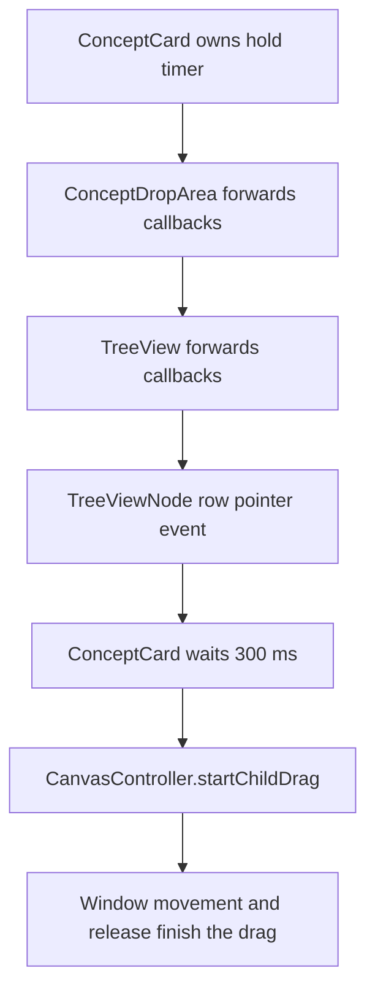

# 8. Trees and containment

[Canvas](07-canvas.md) · [Worked solution](solutions/08-trees-and-containment.md) · [Navigation and cameras](09-navigation-and-cameras.md)

## Containment model

A tree displays instance containment, not permanent ownership between Concepts. A Concept supplies shared identity, title, properties, and tags. Each instance has its own nullable `parentInstanceId`, so two occurrences of the same Concept can have different parents and different children.

`null` means root placement. Root is not a hidden Concept or a synthetic persisted instance. An instance has at most one immediate containment parent; semantic relationships are a separate model, covered in [Relationships](03-relationships.md).

This chapter uses the distinctions in [Concepts and instances](02-concepts-and-instances.md) and the shared access pattern in [Editor and context](04-editor-and-context.md). Its optional child-count exercise does not require earlier exercise changes.

## Source responsibilities

| Source                                                    | Responsibility and main operations                                                                                |
| --------------------------------------------------------- | ----------------------------------------------------------------------------------------------------------------- |
| `src/lib/components/editor/Editor.svelte.ts`              | Derives card views; answers `getChildCards`, `getRootCards`, and ancestry queries; coordinates persisted updates. |
| `src/lib/components/editor/tree/TreeView.svelte`          | Chooses a global or instance-owned root and renders its immediate children.                                       |
| `src/lib/components/editor/tree/TreeViewNode.svelte`      | Renders one occurrence, owns local expansion state, and recursively renders children.                             |
| `src/lib/components/editor/card/ConceptDropArea.svelte`   | Embeds a card-rooted tree and exposes the containment drop target.                                                |
| `src/lib/components/editor/card/ConceptCard.svelte`       | Supplies child-row hold-to-drag callbacks and owns the 300 ms timer.                                              |
| `src/lib/components/editor/sidebar/ConceptSidebar.svelte` | Embeds the global tree without child-drag callbacks.                                                              |

The model files `src/lib/model/ConceptInstance.ts` and `ConceptCardView.ts` define the persisted parent link and the display pairing respectively. `EditorContext.ts` provides the workspace Editor; components do not load records independently.

## Main containment queries

The Editor's two principal queries are small filters:

```ts
getChildCards(conceptInstanceId: string): ConceptCardView[] {
	return this.cards.filter((card) => card.instance.parentInstanceId === conceptInstanceId);
}

getRootCards(): ConceptCardView[] {
	return this.cards.filter((card) => card.instance.parentInstanceId === null);
}
```

`getChildCards` takes a **parent instance ID**, not a Concept ID or title. Matching Concept IDs would incorrectly combine children from separate occurrences. Matching titles would additionally confuse distinct Concepts that happen to share a name.

Both queries return card views, giving a row access to the instance's identity and parent link as well as the Concept's shared title. They return immediate children only, not a recursive list of descendants.

The `cards` collection is derived by joining instances to `conceptsById` through `instance.conceptId`. An instance with no matching Concept produces no card view, so these queries are queries of renderable cards rather than a raw record count. The join is detailed in [Loading and derived cards](05-loading-and-derived-cards.md).

No child-ID array is stored on a Concept or instance. Parent links are sufficient to derive the downward view.

## Choosing a tree root

`TreeView.svelte` accepts an optional `rootCard`. Its main derived collection is:

```ts
let rootConceptInstances = $derived.by(() => {
	if (rootCard) {
		return editor.getChildCards(rootCard.instance.id);
	}

	return editor.getRootCards();
});
```

Despite its name, `rootConceptInstances` contains `ConceptCardView` objects.

| Use                                          | Root row                                      | Immediate rows below it                  |
| -------------------------------------------- | --------------------------------------------- | ---------------------------------------- |
| `<TreeView />` in the sidebar                | UI label `Root`                               | Cards whose `parentInstanceId` is `null` |
| `<TreeView rootCard={card} ... />` in a card | The supplied occurrence's title or Concept ID | Cards whose parent is `card.instance.id` |

The visible root row owns local `rootExpanded`, initially `true`. Its children begin at `aria-level={2}`. The label and indentation describe a presentation; they do not add parent records.

`ConceptDropArea` renders its tree only when the card has children. An empty card instead displays `Drop children here`. Therefore a zero-child card does not currently show a tree root row to which a count could be appended.

## Recursive rows and local expansion

`TreeViewNode.svelte` receives a card, a display level, and optional pointer callbacks. Its principal state is:

```ts
let expanded = $state(false);
let children = $derived(editor.getChildCards(card.instance.id));
let hasChildren = $derived(children.length > 0);
let displayTitle = $derived(card.concept.title || card.concept.id);
```

Expansion belongs to this component instance. Expanding an occurrence in one rendered tree does not instruct every other representation of that occurrence to expand.

A parent row renders a toggle; a leaf renders a spacer. When expanded, a row renders the same component for each immediate child:

```svelte
{#each children as child (child.instance.id)}
	<TreeViewNode card={child} level={level + 1} {onChildPointerDown} {onChildPointerUp} />
{/each}
```

This recursion repeats the query at each depth. `level + 1` supplies accessibility hierarchy information, not persisted ancestry. Keys use instance IDs because repeated occurrences of a Concept need distinct component identities.

Changing `expanded` changes rendered rows. Changing `parentInstanceId` changes containment and can require persistence. A display feature should not conflate those operations.

## Example: repeated Concepts, separate subtrees

The following invented instance structure contains two occurrences of Bicycle:

```text
Root
├─ Garage [garage-A]
│  └─ Bicycle [bicycle-A]
│     └─ Repair checklist [checklist-A]
└─ Transportation [transportation-A]
   └─ Bicycle [bicycle-B]
```

Both Bicycle instances reference the same Bicycle Concept. `getChildCards('garage-A')` returns `bicycle-A`; `getChildCards('transportation-A')` returns `bicycle-B`. Only `getChildCards('bicycle-A')` returns the checklist.

An action trace for expanding the Garage row is:

1. The toggle changes that row component's `expanded` to `true`.
2. `children` already derives the immediate card views beneath `garage-A`.
3. The keyed loop mounts a Bicycle row for `bicycle-A`.
4. That row starts collapsed and independently queries children beneath `bicycle-A`.
5. Expanding Bicycle mounts the checklist row without changing any parent links.

The checklist does not appear beneath `bicycle-B`, even though both Bicycle rows share the same Concept metadata.

## Hold-to-drag and callback boundaries

The tree components do not implement a timer themselves. Ordinary node rows invoke optional `onChildPointerDown(event, card)` and `onChildPointerUp()` callbacks. The up callback is also used for pointer cancellation. Both callbacks pass through each recursive level.

For card trees, the callback route is:



`handleChildTilePointerDown` in `ConceptCard` accepts primary-button presses and ignores buttons, inputs, textareas, and selects. It stops propagation, records the child card, and starts the 300 ms timer. If the timer fires, it calls `editor.canvas.startChildDrag`.

`cancelChildTileHold` clears the timer and pending child. Row pointer-up/cancel callbacks and component destruction invoke cancellation. Do not assume the tree implements a separate movement-based hold cancellation policy; preserve the actual callbacks.

The sidebar uses `<TreeView />` without those callbacks. It supports expansion, but does not activate this card-owned hold-to-drag path. A grab cursor alone is not evidence of supported dragging.

## Drop targets and navigation limits

Once a child drag starts, the controller renders a ghost and finishes on window pointer release. `finishChildDrag` can apply a tag, reparent the existing instance into a card, or place it on the current canvas with world coordinates. Its containment checks reject self/descendant destinations; dropping into a card also skips another immediate occurrence of the same Concept. These are interaction-path rules, not a global title-uniqueness rule.

Drop detection uses `document.elementFromPoint`, `.concept-drop-area`, and instance data attributes. Tree rows expose `data-instance-id` and `data-concept-id`; cards use `data-card-instance-id`. Preserve these interfaces and instance-based loop keys when changing markup.

Double-clicking blank drop-area space opens the enclosing card's canvas. `openCardFromDropArea` deliberately ignores `.tree-root-row` and `.tree-node-row`. The current node component does not implement complete row-opening double-click or keyboard navigation. Expansion must not be documented as instance opening.

## Optional exercise: immediate child counts

Display `Title (N)` on every rendered ordinary node and visible root row. Count immediate children, independent of whether a row is expanded.

Edit only `src/lib/components/editor/tree/TreeView.svelte` and `TreeViewNode.svelte`:

1. Derive an ordinary row's count from its existing `children.length`.
2. Derive the visible root row's count from `rootConceptInstances.length`.
3. Append the counts to the existing label text without changing title attributes.
4. Preserve toggles, expansion, recursion, pointer callbacks, keys, and data attributes.
5. Do not add a model field, Editor query, API request, recursive descendant counter, or CSS.

In the invented example, Garage displays `(1)` even when its Bicycle and checklist descendants are visible. Bicycle A displays `(1)` and Bicycle B displays `(0)`. Root displays `(2)`. The count is derived information, not another record to keep synchronized after moves.

This exercise is self-contained. The [worked solution](solutions/08-trees-and-containment.md) supplies both component edits.

## Safe verification and reversal

Run `npm run check` from the project root using native WSL Node/npm after implementing the exercise. Inspect existing structure to compare the global root count, card-root count, parent count, and leaf `(0)`. Expanding grandchildren must not change an ancestor's immediate count.

**Counts and expansion do not require writes, but navigation and dragging can write live JSON.** Before testing hold-to-drag, containment changes, or camera navigation, stop the app and make and verify an external backup of all four JSON files in `src/lib/data/`, or use an isolated disposable copy with its own data. Tag drops can change shared Concepts as well as instance-related workflows. Do not create or move personal records merely to manufacture test cases, and do not run automated mutation tests against live storage.

On protected data, verify the 300 ms card-tree drag and early-release cancellation still work; do not expect sidebar hold-to-drag. If no suitable existing hierarchy is available, leave the relevant manual check unverified rather than claiming it passed.

To reverse the exercise, remove only the two count declarations and appended label text. Do not alter parent links or restore data blindly. If a tested interaction requires restoration, stop the app, restore related files together, and preserve any desired changes made after the backup.

## Summary

- Containment is derived from `parentInstanceId`; children belong to a particular occurrence, not its shared Concept.
- `TreeView` chooses the root; `TreeViewNode` recursively queries children and owns local expansion.
- Card trees supply the 300 ms hold-to-drag callbacks; the sidebar tree currently does not.
- Immediate counts are presentation derived from existing child arrays and need no persistence changes.
