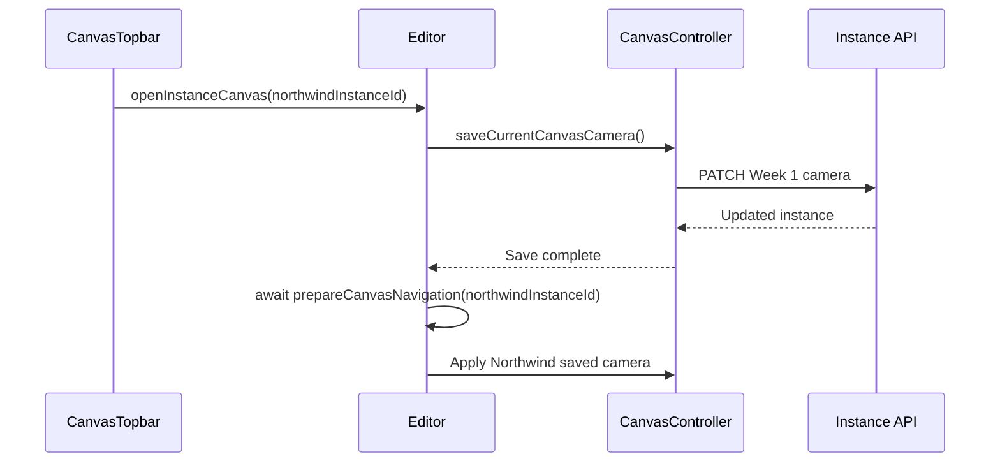

# 9. Navigation and cameras

[Trees and containment](08-trees-and-containment.md) · [Worked solution](solutions/09-navigation-and-cameras.md) · [Creation and title editing](10-creation-and-title-editing.md)

## Navigation state and view state

Navigation selects the instance whose immediate children form the visible canvas. The camera determines how those children are viewed. An instance can own a child canvas even when it has no children yet.

`Editor.currentCanvasOwnerInstanceId` is the navigation state. `null` selects root instances; any other value identifies a particular owning occurrence. The live camera is the controller's `{ panX, panY, zoom }`. Saved camera fields belong to the owner instance, not to its reusable Concept or to each visible child.

This chapter depends on the coordinate model in [Canvas](07-canvas.md) and parent-instance queries in [Trees and containment](08-trees-and-containment.md). The optional depth display requires no earlier exercise implementation.

## Source responsibilities

| Source                                                        | Responsibility and main operations                                                                                                         |
| ------------------------------------------------------------- | ------------------------------------------------------------------------------------------------------------------------------------------ |
| `src/lib/components/editor/Editor.svelte.ts`                  | Owns canvas owner state; implements `openRootCanvas`, `openInstanceCanvas`, and `openParentCanvas`; derives visible cards and breadcrumbs. |
| `src/lib/components/editor/canvas/CanvasController.svelte.ts` | Implements `saveCurrentCanvasCamera`, `getSavedCameraForInstance`, `applyCamera`, and content framing.                                     |
| `src/lib/components/editor/canvas/CanvasTopbar.svelte`        | Renders breadcrumb buttons and the current title through Editor context.                                                                   |
| `src/lib/components/editor/card/ConceptDropArea.svelte`       | Opens an instance canvas on a double-click in blank child-area space, excluding tree rows.                                                 |
| `src/lib/model/ConceptInstance.ts`                            | Defines parent linkage and `lastCameraPanX`, `lastCameraPanY`, and `lastCameraZoom`.                                                       |
| `src/lib/client/conceptInstances.ts`                          | Sends instance updates through `updateConceptInstanceRecord`.                                                                              |
| `src/lib/server/repositories/conceptInstanceRepository.ts`    | Reads and writes instance records in JSON.                                                                                                 |

`ConceptCanvas.svelte` renders the live camera transform. The page loader and `ConceptEditor.svelte` maintain the ordinary refreshed-data bridge; navigation does not create a new Editor or controller.

## Opening the root canvas

The public navigation methods establish the sequence. Root navigation is:

```ts
async openRootCanvas() {
	await this.canvas.saveCurrentCanvasCamera();
	await this.prepareCanvasNavigation(null);

	if (this.cardsInCurrentCanvas.length > 0) {
		this.canvas.frameCardsInCurrentCanvas();
	} else {
		this.canvas.applyCamera({ panX: 0, panY: 0, zoom: 1 });
	}
}
```

The outgoing camera must be saved before the owner changes, or the save would target the wrong instance. The call to `prepareCanvasNavigation(null)` is also **awaited**: framing follows the Svelte view update rather than racing it.

Root has no instance record from which to restore a camera. It frames root cards or applies the neutral camera when empty. Clicking the root breadcrumb while already at root can therefore reframe the view; it is not guarded as a same-owner no-op.

## Opening an instance canvas

`openInstanceCanvas` first resolves the target and rejects an absent card or the already-open owner:

```ts
async openInstanceCanvas(instanceId: string) {
	const targetCard = this.getCard(instanceId);

	if (!targetCard || instanceId === this.currentCanvasOwnerInstanceId) {
		return;
	}

	await this.canvas.saveCurrentCanvasCamera();
	await this.prepareCanvasNavigation(instanceId);

	const savedCamera = this.canvas.getSavedCameraForInstance(targetCard.instance);

	if (savedCamera) {
		this.canvas.applyCamera(savedCamera);
	} else if (this.cardsInCurrentCanvas.length > 0) {
		this.canvas.frameCardsInCurrentCanvas();
	} else {
		this.canvas.applyCamera({ panX: 0, panY: 0, zoom: 1 });
	}
}
```

The intended alternatives are saved-camera restoration, framing, and a neutral empty view. The current helper always returns a camera object, however, so a valid target currently takes the first branch. A nullable return type does not establish that a function actually returns `null`.

`openParentCanvas` resolves the current owner's parent. It awaits `openRootCanvas()` for a root-level owner and otherwise awaits `openInstanceCanvas(parentInstanceId)`. At root it returns immediately. Parent navigation reuses the public sequence instead of implementing a separate camera policy.

## Clearing interactions before changing owners

The supporting sequencing helper is:

```ts
async prepareCanvasNavigation(nextOwnerInstanceId: string | null) {
	this.canvas.clearInteractiveState();
	this.clearSelection();
	this.closeContextMenu();

	this.currentCanvasOwnerInstanceId = nextOwnerInstanceId;
	this.activeInstanceId = null;

	await tick();
}
```

The controller resets pan/drag/resize/marquee interaction state; the Editor clears selected and active instances and closes the context/import menus. This avoids carrying a selection or unfinished spatial gesture into a different context.

`tick()` waits for pending Svelte updates after changing the owner. It is not a network request or a data reload. Camera framing can then use the new view rather than depending on stale rendered content.

## Visible cards, breadcrumbs, and depth

The visible canvas uses the same immediate-child rule as the tree:

```ts
cardsInCurrentCanvas = $derived(
	this.cards.filter((card) => card.instance.parentInstanceId === this.currentCanvasOwnerInstanceId)
);
```

At root the comparison value is `null`. Inside an occurrence it is that occurrence's instance ID. Two occurrences of the same Concept can show different child cards and remember different cameras.

`currentBreadcrumb` returns `[]` at root. Otherwise it calls `getInstanceBreadcrumb(ownerId)`. That helper starts at the owner, follows `parentInstanceId`, and prepends each card, producing ancestor-to-owner order. A visited `SvelteSet` stops repeated IDs if malformed data contains a cycle; a missing card also ends traversal. These protections stop the walk but do not repair data.

For a valid containment path:

```text
Canvas owner                  Breadcrumb       Depth
root                          []               0
root instance A               [A]              1
child B of A                  [A, B]           2
child C of B                  [A, B, C]        3
```

Depth is breadcrumb length, not visible-card count or a stored field. With malformed or incomplete ancestry it represents the resolved breadcrumb, not a separately validated full path. The topbar keys breadcrumb buttons by instance ID; equal labels need not identify the same occurrence.

## Saving cameras without invalidation

For a non-root owner, `saveCurrentCanvasCamera` takes a snapshot, updates that owner's in-memory camera fields when its card exists, then awaits:

```ts
const savedInstance = await updateConceptInstanceRecord(this.editor.currentCanvasOwnerInstanceId, {
	lastCameraPanX: camera.panX,
	lastCameraPanY: camera.panY,
	lastCameraZoom: camera.zoom
});
this.editor.rememberSavedInstance(savedInstance);
```

The client sends `PATCH /api/concept-instances`. The instance API/repository path writes the fields to `src/lib/data/concept_instances.json`.

This save deliberately calls the client directly **without `invalidateAll()`**. Ordinary Editor record mutations usually invalidate, reload canonical records, and bridge them back through `replaceData()`. Camera navigation avoids that full refresh and updates the relevant in-memory fields itself. After a successful response, `rememberSavedInstance` also advances that instance in the rollback baseline, so an unrelated failed save cannot restore an older camera. Replacing it with `editor.updateInstance()` would change that behavior.

The save is awaited, and a client error rejects the navigation call before owner preparation. There is no rollback in this method for the camera fields already assigned in memory. A completed UI render is not proof that a camera write succeeded; check requests/errors when verifying persistence.

## Existing zoom-default discrepancy

Three current paths use different defaults:

- `normalizeConceptInstance` defaults missing `lastCameraZoom` to **`0`**.
- Creation in `conceptService.ts` and `conceptInstanceRepository.ts` defaults it to **`1`**.
- `getSavedCameraForInstance` uses `instance.lastCameraZoom ?? 1` and always returns an object.

Nullish coalescing preserves a numeric zero. Once normalization has supplied `0`, the helper's fallback does not replace it, and `applyCamera` does not clamp it. A zero scale can hide the world, and inverse coordinate calculations divide by zoom. The wheel handler's normal `0.1`–`5` clamp is not validation of restored cameras.

This is an existing behavior/data-default decision, not something to fix incidentally while adding a depth label. Do not edit JSON, change normalizers, or claim all instance canvases automatically frame when no meaningful camera has been saved.

## Action trace: breadcrumb navigation

Suppose the current owner is Week 1 in `Root > Client Meetings > Northwind > Week 1`. Clicking the Northwind breadcrumb follows this sequence:



Week 1's camera stays with the Week 1 instance. The owner changes to Northwind, its immediate children become visible, and the breadcrumb shortens. The controller applies Northwind's saved view; neither Concept identity nor containment changes during this navigation.

## Optional exercise: current canvas depth

Edit only `src/lib/components/editor/canvas/CanvasTopbar.svelte`:

1. After obtaining `editor` from context, derive `currentCanvasDepth` from `editor.currentBreadcrumb.length`.
2. Display `Canvas depth: N` inside the existing title block, after its owner/root conditional.
3. Keep the current title, breadcrumb buttons, and action handlers intact.
4. Add no model fields, API calls, controller methods, traversal code, or CSS.

Root must display `0`. A canvas owned by a root instance must display `1`, regardless of how many child cards are visible. See the [worked solution](solutions/09-navigation-and-cameras.md) for the complete additions.

## Safe verification and reversal

Run `npm run check` from the project root with native WSL Node/npm. It validates the component change, not navigation or persistence at runtime.

**Navigation away from a non-root canvas writes camera fields even if the depth feature is display-only.** Before browser navigation/camera tests, stop the app and make and verify an external backup of all four JSON files under `src/lib/data/`, or use an isolated disposable application copy with its own storage. Do not run automated mutation tests against live data or rely on an older archive as a current backup.

On protected data, verify root depth `0`, a root instance's canvas depth `1`, and deeper existing owners. Navigate upward with breadcrumb buttons and confirm the resolved depth decreases. Confirm opening the current owner remains a no-op, selection does not leak, and leaving then returning restores the existing camera. Test root framing separately from nested restoration. Avoid Grid or drag operations unless their data mutations are intentional.

To reverse the exercise, remove only the derived declaration and appended depth text. Completed camera writes are not undone by removing the display. Restore data only with the app stopped, restore related files together, and do not overwrite desired edits made since the backup.

## Summary

- Navigation changes the owner instance; visible cards are its immediate children.
- Public navigation saves the outgoing camera, awaits owner preparation, then restores or frames the incoming view.
- Root awaits preparation and frames content rather than restoring an instance camera.
- Nested-camera persistence bypasses invalidation; the existing zero-versus-one zoom default remains a separate unresolved behavior.
- Current canvas depth is derived from the existing breadcrumb and needs no persisted field.
