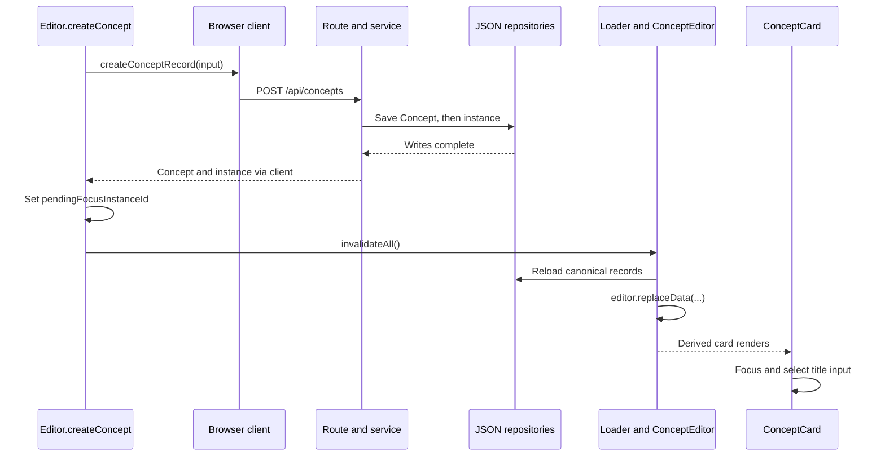

# 10. Creation and title editing

Creation adds a Concept and an occurrence. Title editing starts from an existing occurrence and can change which Concept it represents. Both operations cross the browser/server boundary, but they have different identity rules.

This chapter follows the commands first, then their input handlers, HTTP calls, and persistence helpers. The optional exercise adds a New Card button; it does not change title behavior.

## Responsibilities and main functions

| File                                                                                  | Responsibility and main functions                                                                                                                                                          |
| ------------------------------------------------------------------------------------- | ------------------------------------------------------------------------------------------------------------------------------------------------------------------------------------------ |
| `src/lib/components/editor/Editor.svelte.ts`                                          | `createConcept` supplies creation defaults and refreshes records. `commitTitleEdit` skips unchanged input; `updateConceptTitleFromInstance` coordinates title requests and conflict state. |
| `src/lib/components/editor/canvas/CanvasController.svelte.ts`                         | Handles canvas and title-input events. Chooses placement using `getViewportCenterWorldPoint`, pointer conversion, or `getNearbyCardPosition` from `layout.ts`.                             |
| `src/lib/components/editor/card/ConceptCard.svelte`                                   | Displays one card's title input and focuses it when `pendingFocusInstanceId` matches.                                                                                                      |
| `src/lib/client/concepts.ts`                                                          | `createConceptRecord` and `updateConceptTitleFromInstanceRecord` send HTTP requests and interpret responses.                                                                               |
| `src/routes/api/concepts/+server.ts`                                                  | `POST` delegates creation; `PATCH` requires both IDs for title edits and translates service results into HTTP responses.                                                                   |
| `src/lib/server/conceptService.ts`                                                    | `createConceptWithInstance` constructs linked records. `updateConceptTitleFromInstance` applies reassignment and conflict rules.                                                           |
| `src/lib/server/repositories/conceptRepository.ts` and `conceptInstanceRepository.ts` | Read collections, generate IDs, and write the two JSON files.                                                                                                                              |

The [loading and derived cards chapter](05-loading-and-derived-cards.md) explains the return path from persistence to rendering. [Cards](06-cards.md) covers the component itself; [HTTP and persistence](12-http-and-persistence.md) covers the transport and storage boundaries in more detail.

## Creating a Concept and its first instance

`Editor.createConcept` is the existing editor-level entry point:

```ts
async createConcept(options: CreateConceptOptions = {}) {
	const sizePreset = options.sizePreset ?? 'medium';
	const presetSize = conceptSizePresets[sizePreset];

	const result = await createConceptRecord({
		...(options.position ?? {}),
		...(options.title !== undefined ? { title: options.title } : {}),
		width: options.width ?? presetSize.width,
		height: options.height ?? presetSize.height,
		parentInstanceId: options.parentInstanceId ?? this.currentCanvasOwnerInstanceId
	});

	if (options.focusAfterCreate ?? true) {
		this.pendingFocusInstanceId = result.instance.id;
		this.activeInstanceId = result.instance.id;
	}

	await invalidateAll();

	return result;
}
```

The command keeps several policies out of components:

- Dimensions default to the medium preset unless overridden.
- Parentage defaults to the open canvas owner instance. At root this is `null`; inside an occurrence it is that occurrence's ID.
- Focus intent uses the returned **instance ID**, because several cards may represent the same Concept.
- Successful creation calls `invalidateAll()` rather than inserting a component-local card.

The parent expression uses `??`: an explicit `null` also falls back to the current owner. It is not an override for root creation while inside another canvas.

`createConceptRecord` sends `POST /api/concepts`. The route passes the parsed input to `createConceptWithInstance`. That service creates:

1. A Concept with a new ID, a trimmed title (blank by default), empty properties, and no tags.
2. An instance with its own new ID and `conceptId` referring to that Concept.

The instance stores parentage, geometry, and camera defaults. If no position was supplied, the service defaults `x` to `32 + instances.length * 248` and `y` to `32`. Creation does not search for a same-title Concept or enforce title uniqueness.

Supporting helpers `createConceptId` and `createConceptInstanceId` generate separate UUID-based IDs. `saveAllConcepts` then `saveAllConceptInstances` write the complete collections. These sequential writes are **not a transaction**; a successful first write does not guarantee the second will succeed.

## Refresh and title focus

After the response, `Editor.createConcept` records focus intent and awaits invalidation:



`ConceptEditor.svelte` passes refreshed data into the **existing** Editor through `replaceData()` inside `untrack()`. `Editor.cards` joins instances to Concepts, and `cardsInCurrentCanvas` filters by parent instance ID. No Card record is written.

In `ConceptCard.svelte`, an effect waits for both a matching `pendingFocusInstanceId` and a mounted title input. It focuses/selects the input and clears that pending ID. The DOM work belongs to the component, not the service.

## Title editing changes the represented Concept

A card displays `card.concept.title`, but edits begin from `card.instance`. `Editor.commitTitleEdit` trims the input and returns without a request if it exactly equals the current Concept title. Otherwise it calls the editor's `updateConceptTitleFromInstance` method.

That method sends the Concept ID, instance ID, requested title, and conflict mode through `updateConceptTitleFromInstanceRecord`. On success it clears `titleConflict` and invalidates. On a conflict it stores the card, requested title, and matching Concepts, then returns without invalidation.

The route's `PATCH` branch requires an instance ID when changing a title. Missing IDs produce `400`; missing records produce `404`. A service conflict produces `409` with code `TITLE_CONFLICT`, which the client converts to a `title-conflict` result. Unknown conflict modes fall back to `report-conflict`.

**The current components do not render a complete conflict chooser.** Stored conflict state and supported service modes are not a finished selection/confirmation interface.

### Service decision order

`src/lib/server/conceptService.ts:updateConceptTitleFromInstance` loads the supplied Concept and instance, trims the requested title, and finds **other** Concepts with the same trimmed, case-insensitive title. An empty requested title has no matches.

The order matters:

| Condition                                                                                                 | Result                                                                                                                          | Files written |
| --------------------------------------------------------------------------------------------------------- | ------------------------------------------------------------------------------------------------------------------------------- | ------------- |
| Matches exist; `report-conflict`                                                                          | Return matching Concepts without changing records.                                                                              | Neither       |
| Matches exist; `use-existing`                                                                             | Set this instance's `conceptId` to the first matching Concept ID. Its displayed metadata now comes from that Concept.           | Instances     |
| No earlier return; original title is blank, exactly one instance uses it, and requested title is nonempty | Name the original blank Concept in place.                                                                                       | Concepts      |
| Otherwise                                                                                                 | Create a new Concept, copy the original properties and tag IDs, and reconnect this instance to it. Retain the original Concept. | Both          |

`create-duplicate` bypasses reuse/conflict reporting; it still reaches the blank-Concept special case before the new-Concept branch. It does not force a new ID when naming a singly used blank Concept. `use-existing` with no match also proceeds to those later branches.

Naming a blank, singly used Concept is the narrow in-place exception. Editing an already named occurrence is not a global rename of the shared Concept. Clearing a named title reaches the new-Concept branch with an empty title. Different Concept IDs may legitimately have equal titles.

The current `use-existing` implementation chooses `matchingConcepts[0]`. That is an identity shortcut, not complete same-name disambiguation. Reusing a Concept takes its shared metadata; it does not merge or copy the previous Concept's metadata into the target.

### Identity and containment remain distinct

When reassignment changes `instance.conceptId`, it preserves the instance's:

- `id` and `parentInstanceId`;
- position and dimensions;
- saved camera fields;
- children, whose `parentInstanceId` still points to the unchanged instance ID.

Other instances still refer to the original Concept. No instance-local title is added, and unused Concepts are not automatically deleted.

For example, suppose instance A in Garage and instance B in Transport both reference Bicycle. Editing A to `Scooter` has these outcomes:

1. If Scooter already exists, the default request reports a conflict without writing either file. The Editor stores it, but no complete chooser appears.
2. A deliberate caller retry with `use-existing` connects A to the first matching Scooter Concept, including its properties/tags. B still represents Bicycle.
3. If there is no match, the service creates a new Scooter Concept with Bicycle's copied properties/tags, then reconnects A. Bicycle remains unchanged for B.
4. A's children, parent, geometry, camera, and instance ID remain unchanged in either reassignment.

These are service traces, not instructions to test against personal records.

## Input behavior: two double-Enter paths

The input in `ConceptCard.svelte` delegates `keydown` to `handleConceptTitleKeydown` and blur to `handleConceptTitleBlur`. Its double-click handler stops propagation.

| Entry point                                  | Current behavior                                                                                                                   |
| -------------------------------------------- | ---------------------------------------------------------------------------------------------------------------------------------- |
| Enter in a title input                       | Prevent default, record the title-specific Enter target, and await `commitTitleEdit`.                                              |
| Second Enter in the same title within 450 ms | After the commit returns, create a blank card at `getNearbyCardPosition(card)`.                                                    |
| Escape in a title input                      | Restore `card.concept.title` in the input, then blur; blur calls the normal commit path, normally a no-op for that restored value. |
| Blur                                         | Commit the current input value.                                                                                                    |
| Double Enter outside interactive elements    | `handleWindowKeydown` creates at viewport center.                                                                                  |
| Canvas double-click                          | Convert pointer position to world coordinates and create with a random offset of up to 100 units per axis.                         |

`consumeDoubleEnter` compares the previous target ID and timestamp, then updates both. Title targets use `title:<instance ID>`; canvas targets use `canvas:<owner instance ID or root>`. It does not itself check whether the event was Enter. The window handler excludes focused inputs, buttons, and other interactive elements.

The title handler does **not** test whether a conflict was resolved before creating nearby: `commitTitleEdit` returns normally after storing a reported conflict. It also does not blur on Enter. Preserve these actual behaviors rather than assuming a completed confirmation workflow.

## Optional exercise: add a New Card button

Add a small composition command to `Editor`:

1. In `src/lib/components/editor/Editor.svelte.ts`, add `async createConceptAtViewportCenter()` immediately above `createConcept`.
2. Get the position from `this.canvas.getViewportCenterWorldPoint()` and return `this.createConcept({ position })`.
3. In `src/lib/components/editor/canvas/CanvasTopbar.svelte`, add one `New Card` button inside `concept-topbar-actions`, before the existing grouped controls. Call `editor.createConceptAtViewportCenter()` through an arrow callback.
4. Reuse the existing context. Do not add HTTP calls, defaults, camera arithmetic, CSS, or schema changes.
5. Leave both keyboard handlers and title behavior unchanged.

This method and button are proposed exercise code, not existing application features. [Integration](13-integration.md) requires this implementation, moves the method to `CanvasController`, and revises the same button rather than adding another.

The supporting coordinate helper computes:

```text
world x = (canvas viewport width / 2 - panX) / zoom
world y = (canvas viewport height / 2 - panY) / zoom
```

For a 1000 × 600 viewport, pan `(100, -50)`, and zoom `2`, the point is `(200, 175)`. This becomes the card's **top-left anchor**, not its geometric center. The helper returns `(0, 0)` if no canvas element is bound.

## Safe backup and restore for manual checks

Creation writes both `src/lib/data/concepts.json` and `src/lib/data/concept_instances.json`. Title editing can write either or both. Navigation/camera and geometry interactions can also write instances. These files contain personal data, not test fixtures.

Prefer disposable isolated storage. If checking the exercise against this checkout, stop the application and all other writers first. In native WSL Ubuntu, from `/home/cory/development/concept-editor`, create a fresh directory **outside the project**:

```sh
mkdir -m 700 /home/cory/concept-editor-tutorial-10-backup
```

If it fails or already exists, stop. Choose another unused literal directory name and use it consistently in every command below; do not reuse or overwrite an uncertain backup. Then copy and verify the pair:

```sh
cp -p src/lib/data/concepts.json /home/cory/concept-editor-tutorial-10-backup/concepts.json &&
cp -p src/lib/data/concept_instances.json /home/cory/concept-editor-tutorial-10-backup/concept_instances.json &&
cmp src/lib/data/concepts.json /home/cory/concept-editor-tutorial-10-backup/concepts.json &&
cmp src/lib/data/concept_instances.json /home/cory/concept-editor-tutorial-10-backup/concept_instances.json &&
printf 'Paired backup verified\n'
```

Continue only if every command succeeds and the verification message appears. Do not touch `data-backup-do-not-delete-project-level-data.zip`. This pair protects the operations described here, not later relationship edits or other storage changes.

To roll back only exercise mutations, stop the app and all writers again. **Do not restore if desired edits were made after the backup**, including titles, metadata, containment, geometry, or cameras. Preserve the current state separately and reconcile deliberately instead. If the backed-up pair is exactly the state you want:

```sh
test -s /home/cory/concept-editor-tutorial-10-backup/concepts.json &&
test -s /home/cory/concept-editor-tutorial-10-backup/concept_instances.json &&
cp -p /home/cory/concept-editor-tutorial-10-backup/concepts.json src/lib/data/concepts.json &&
cp -p /home/cory/concept-editor-tutorial-10-backup/concept_instances.json src/lib/data/concept_instances.json &&
cmp src/lib/data/concepts.json /home/cory/concept-editor-tutorial-10-backup/concepts.json &&
cmp src/lib/data/concept_instances.json /home/cory/concept-editor-tutorial-10-backup/concept_instances.json &&
printf 'Paired restore verified\n'
```

If any restore step fails, keep the app stopped until both files are restored and verified. Keep the external backup. Deleting a test instance alone is not exact rollback: its Concept remains. Never regenerate IDs or delete arbitrary records to undo the exercise.

## Verification and source cleanup

Run `npm run check` before manual interaction. This is static validation, not evidence of persistence or browser behavior.

After a verified backup, optional manual checks are:

- Pan/zoom, then click New Card. Confirm its top-left anchor is at the visible-center world point and its title input receives focus.
- Create at root and inside an occurrence. Confirm `parentInstanceId` is respectively `null` and that exact owner instance ID.
- Check browser requests/errors and reload to confirm persistence.

No title mutation is needed to verify the button. Review title decisions statically or use isolated disposable data; do not manufacture conflicts in personal records. Do not run mutation tests against the live JSON store.

Keep the command and button if continuing to integration. To remove this exercise instead, remove only `Editor.createConceptAtViewportCenter()` and its New Card button, then rerun `npm run check`. Data rollback is separate and follows the paired-restore rules above.

[Exercise solution](solutions/10-creation-and-title-editing.md) · [Next: Properties and tags](11-properties-and-tags.md)

## Summary

- Creation persists a new Concept and a distinct instance; derived cards appear through invalidation and `replaceData`.
- Title edits operate through an occurrence. They may reuse a Concept, name one singly used blank Concept, or create a Concept and reassign the instance.
- Reassignment preserves occurrence identity, containment, children, geometry, and camera. Titles are not unique IDs.
- Conflict reporting exists, but the complete chooser does not. Title-input double Enter creates nearby, independently of canvas-center creation.
- The optional New Card command composes existing APIs without changing persistence or title semantics.
