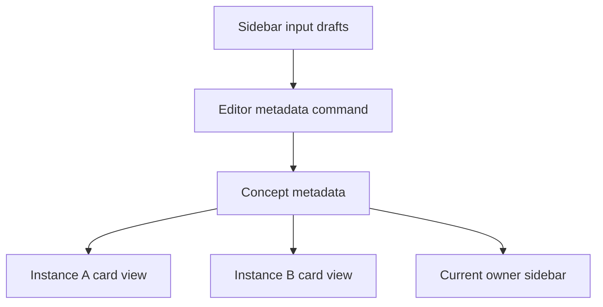

# 11. Properties and tags

Properties and tags are shared Concept metadata. They describe the reusable thing, not one placement of it. Two instances of the same Concept therefore share metadata while retaining independent geometry, parents, children, and cameras.

This chapter covers metadata ownership, editing commands, local input drafts, and tag identity. Its display-only exercise does not require changes from earlier exercises; the relationship count from [Relationships](03-relationships.md) may remain if you added it.

## Responsibilities and main functions

| File under `src/lib/`                             | Responsibility                                                              |
| ------------------------------------------------- | --------------------------------------------------------------------------- |
| `model/Concept.ts`                                | Defines shared metadata fields.                                             |
| `model/normalizeConcept.ts`                       | Supplies defaults when Concept records enter the application.               |
| `components/editor/Editor.svelte.ts`              | Owns canonical Concepts, metadata commands, and ID lookup.                  |
| `components/editor/sidebar/ConceptSidebar.svelte` | Edits properties and keeps new-property and sidebar-tag drafts.             |
| `components/editor/ConceptTagsPreview.svelte`     | Renders tag Concepts and emits tag input/open/remove callbacks.             |
| `components/editor/card/ConceptCard.svelte`       | Resolves a card's tag references and connects callbacks to Editor commands. |

The main Editor APIs are:

| Function                                       | Operation                                                                                |
| ---------------------------------------------- | ---------------------------------------------------------------------------------------- |
| `setProperties(card, properties)`              | Replaces the Concept's complete property object and persists it.                         |
| `addTag(card, title)`                          | Finds or creates a Concept by title, then attaches its ID as a tag.                      |
| `removeTag(card, tagConcept)`                  | Removes the tag ID from the target Concept, not the tag Concept itself.                  |
| `setConceptTagConceptIds(card, tagConceptIds)` | Deduplicates IDs, excludes the target's own ID, and persists the complete list.          |
| `getTagConcepts(tagConceptIds)`                | Resolves IDs to loaded Concepts, dropping unresolved references from the display result. |

`tagConceptWithConcept(targetCard, tagConcept)` is the ID-based operation used once the tag Concept is already known. `updateConcept(id, updates)` sends metadata changes through the client and refreshes canonical records after success.

## Metadata shape and identity

`src/lib/model/Concept.ts` defines:

```ts
export type Concept = {
	id: string;
	title: string;
	properties: Record<string, string>;
	tagConceptIds: string[];
};
```

For example:

```ts
const bicycle: Concept = {
	id: 'bicycle',
	title: 'Bicycle',
	properties: { colour: 'blue', gears: '8' },
	tagConceptIds: ['vehicle', 'owned']
};
```

`'8'` is a string, not a numeric property type. `vehicle` and `owned` are Concept IDs, not stored display labels. Their titles are resolved from the loaded Concept collection. Tags are ordinary Concepts and do not need a separate tag entity.

IDs establish identity. Distinct Concepts may have the same title; equal text does not make them the same tag. The current title-based add flow does not yet offer complete disambiguation between them.

The model does not establish required properties, inheritance, arbitrary JSON values, or schema enforcement through tags. These capabilities must not be inferred from flexible metadata.

### Defaults are not validation

`normalizeConcept(concept, index)` fills a missing ID/title, defaults missing properties to `{}`, and defaults `tagConceptIds` to `[]` when it is not an array. It does not resolve IDs or thoroughly validate the contents of those fields.

This differs from defining accepted write input: the normalizer repairs/defaults loaded records; `UpdateConceptInput` in the repository describes supported metadata updates. Neither is a complete runtime schema validator.

## Shared data and local drafts

The sidebar obtains the current owner card from `editor.currentCanvasOwnerCard`. A `ConceptCardView` combines `{ concept, instance }`; it does not move metadata onto the instance.



`newPropertyKey`, `newPropertyValue`, and `sidebarNewTag` are component-local `$state` values. They are incomplete user input, not canonical metadata. The sidebar resets the new-property key/value drafts when the owner instance ID changes, not when refreshed records replace the current card object. The sidebar tag draft is cleared by its add handler; it is not included in that owner-change reset.

Keeping drafts local avoids storing incomplete input in shared Concept records. Committing a draft builds the next complete metadata value and invokes an Editor command.

## Property editing

For an existing `colour` property, changing the value and leaving the input follows this path:

1. The property list renders `Object.entries(sidebarCard.concept.properties ?? {})`.
2. The value input's blur handler calls `updatePropertyValue(card, key, value)`.
3. The helper copies the existing object and sets `[key]: value`.
4. `editor.setProperties(card, nextProperties)` assigns the complete replacement object to `card.concept.properties`.
5. `Editor.updateConcept` sends the change to the server and calls `invalidateAll()` after success.
6. The page loader returns fresh records; `ConceptEditor.svelte` calls the stable editor's `replaceData` inside `untrack`.
7. Derived card views and all metadata displays for that Concept update from the refreshed records.

The [HTTP and persistence](12-http-and-persistence.md) chapter traces the request and file write in detail. The local assignment in step 4 is immediate, but it is not proof that persistence succeeded.

### Sidebar input helpers

After the command path, the supporting helpers explain input policy:

- `updatePropertyKey` trims the new key and rejects empty, unchanged, or already-used names. Otherwise it reconstructs entries with the replacement key.
- `updatePropertyValue` preserves other properties and replaces one value.
- `removeProperty` filters out one entry and passes the remaining complete object to `setProperties`.
- `commitNewProperty` rejects empty or existing keys, submits the draft value, and clears the drafts only after success if the owner and draft text still match the submitted values. A failed save or newer input leaves the drafts intact.
- `handleNewPropertyKeydown` moves focus to the value input on Enter; `handleNewPropertyValueKeydown` commits it. `blurOnEnter` commits existing inputs through their blur handlers.

The preservation step matters: `setProperties(card, { colour: 'blue' })` does not patch only `colour`; it removes every property omitted from that object.

## Tag editing

Adding a typed tag includes a Concept identity lookup before the metadata write:

1. On a card, `ConceptTagsPreview` trims its input and emits `onManualTagAdd`. In the sidebar, `addSidebarTag` trims the separate sidebar input. Both clear their local draft and call `editor.addTag(card, title)`.
2. `addTag` calls client `ensureConceptByTitle`, which sends `POST /api/concepts/ensure`.
3. The repository reuses the first case-insensitive trimmed-title match or creates a new Concept. It does not create a spatial instance for a new tag.
4. If necessary, `addTag` adds the returned Concept to the editor's local Concept collection.
5. `tagConceptWithConcept` appends its ID and delegates to `setConceptTagConceptIds`.
6. That method removes duplicate IDs, excludes self-tagging, and persists the list through `updateConcept`.

`getTagConcepts` resolves references for rendering; it does not delete missing IDs from storage. Removing a tag changes the reference list only and does not delete the tag Concept or its instances.

The find/create request and metadata update are separate operations, not an atomic transaction. A newly created tag Concept can remain unplaced, including if the later attachment fails. Concepts without instances are valid records, not automatic cleanup candidates.

### Current limits

- `ensureConceptByTitle` chooses the first case-insensitive match. It is an incomplete identity shortcut, not a rule that Concept titles are unique.
- `Editor.openTagCanvas(tagConcept)` only logs a message. Tag open callbacks exist, but occurrence selection and navigation are not implemented by those callbacks.
- Basic tag displays and string properties do not imply a table implementation, typed attributes, inheritance, or a status workflow.

## Exercise: derive a metadata summary

Change only `src/lib/components/editor/sidebar/ConceptSidebar.svelte` to display a summary near the current owner's instance ID:

```text
2 properties · 3 tags
```

Requirements:

1. Add a local `metadataSummary` derived value based on `currentCanvasOwnerCard.concept`.
2. Count property keys and stored `tagConceptIds`, not resolved tag Concepts.
3. Use singular `property`/`tag` for exactly one and plural words otherwise.
4. Render only in the existing current-owner branch; root must show no summary.
5. Add no persisted fields, Editor methods, imports, or CSS.
6. Work with the unmodified application; an earlier relationship heading count is optional and must remain independent.

Stored reference count is deliberate. An unresolved tag ID contributes to this summary even though `getTagConcepts` omits it from visible tiles. See the [separate solution](solutions/11-properties-and-tags.md).

## Verification and cleanup

After implementing the exercise, run `npm run check` and `npm run build` from the project root.

Expected text:

| Property keys | Tag IDs | Summary                 |
| ------------: | ------: | ----------------------- |
|             0 |       0 | `0 properties · 0 tags` |
|             1 |       0 | `1 property · 0 tags`   |
|             0 |       1 | `0 properties · 1 tag`  |
|             2 |       3 | `2 properties · 3 tags` |

Check browser behavior only in a disposable project copy with isolated JSON storage; navigation itself may save cameras. Use existing records or disposable fixtures, not live metadata edits, to cover these cases. The summary should change with the owner Concept and agree for different instances of the same Concept. If the relationship count is present, it should continue to work independently.

To undo the exercise, remove only `metadataSummary` and its markup line. The display change requires no metadata rollback.

## Summary

Properties are string entries and tags are Concept-ID references, both shared across a Concept's instances. Components own drafts; Editor commands commit complete metadata values. Display summaries remain derived, and stored reference counts are distinct from successfully resolved tag tiles.

- [Creation and title editing](10-creation-and-title-editing.md)
- [HTTP and persistence](12-http-and-persistence.md)
- [Exercise solution](solutions/11-properties-and-tags.md)
