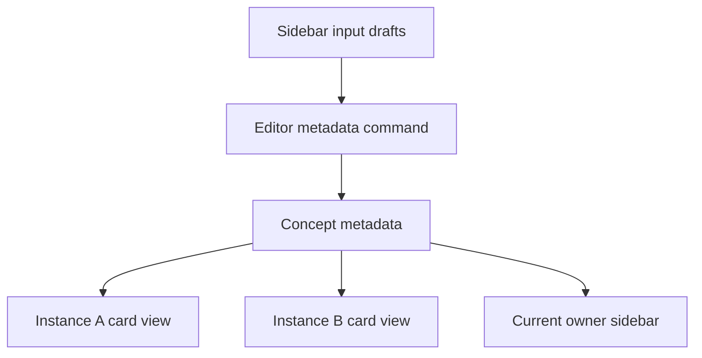

# 11. Properties and tags

Inside a Concept canvas, the property and tag controls described in this chapter edit shared Concept metadata. At the root workspace, the same controls edit the Context record through Context-specific commands and PATCH /api/context. Instances also support their own additive contextual properties in the model, but separate instance-property controls are not implemented. Tag assignments belong to Concepts and Context, not instances. Two instances share Concept metadata while retaining independent notes, contextual properties, geometry, parents, children, and cameras.

This chapter covers metadata ownership, editing commands, local input drafts, and tag identity. Its display-only exercise does not require changes from earlier exercises; the relationship count from [Relationships](03-relationships.md) may remain if you added it.

## Responsibilities and main functions

| File under `src/lib/`                             | Responsibility                                                                                                                     |
| ------------------------------------------------- | ---------------------------------------------------------------------------------------------------------------------------------- |
| `model/Concept.ts` and `model/Context.ts`         | Define metadata with `tagIds` referencing Tags.                                                                                    |
| `model/Tag.ts`                                    | Define `Tag { id, title, representedByConceptId? }`.                                                                               |
| `server/repositories/tagRepository.ts`            | Read/write `tags.json`; `ensureTag` selects typed matches by shared-property count or preserves an explicitly supplied Concept ID. |
| `server/tagService.ts`                            | `materializeTag` links a representing Concept and creates an instance.                                                             |
| `client/tags.ts`                                  | `ensureTag` and `createTagInstance` call the Tag endpoints.                                                                        |
| `components/editor/Editor.svelte.ts`              | Own `tags`, resolve assignments with `getTags`, and coordinate metadata/materialization commands.                                  |
| `components/editor/sidebar/ConceptSidebar.svelte` | Own drafts and choose Context or Concept commands.                                                                                 |
| `components/editor/ConceptTagsPreview.svelte`     | Render native draggable Tag tiles and provide input/remove callbacks.                                                              |

**Status:** separate Tags are implemented end to end, including the stable `Editor.tags` refresh bridge, assignment controls, native draggable tiles, and blank-canvas materialization. The owner reports 113 passing component tests and real-mouse HTML5 browser coverage; see validation below. This documentation update does not rerun those checks.

Existing property commands remain `setProperties(card, properties)` for a Concept and `setContextProperties(properties)` for Context. They replace the complete property object. `updateConcept(id, updates)` and `updateContext(updates)` persist metadata and refresh canonical records after success. Tag assignments use `setContextTagIds`/`setConceptTagIds`. `addContextTag`/`addTag` ensure Tags by title, and `removeContextTag`/`removeTag` remove assignments without deleting Tags. `getTags(tagIds)` resolves the display list from `Editor.tags`.

## Metadata shape and identity

Concept and Context store `tagIds: string[]`. These are Tag IDs, not Concept IDs or display labels. This metadata excerpt refers to separately stored Tags:

```ts
const metadata = {
	properties: { colour: 'blue', gears: '8' },
	tagIds: ['tag-vehicle', 'tag-owned']
};

const vehicleTag: Tag = { id: 'tag-vehicle', title: 'Vehicle' };
```

Property values remain strings. This excerpt omits other Concept/Context fields rather than declaring a complete Concept. Tags carry no Concept metadata or instance children. The optional `representedByConceptId` links to a separate Concept when materialized below.

Tag titles are nonempty and trimmed but may repeat. Typed `Vehicle`/`vehicle` lookup considers the same case-insensitive matches and chooses the Tag whose linked Concept has the most shared properties; ties retain the first Tag in storage order. Unlinked or missing linked Concepts contribute zero. Two ordinary Concepts called Vehicle may coexist; typing a tag does not automatically link either one. Tag and linked Concept titles are independent; renaming either does not rename the other or change the exact-ID link. Future tag filtering uses Tag IDs, not Concept IDs or names.

Flexible metadata does not imply required properties, inheritance, typed attributes, or status workflows.

### Defaults are not migration

`normalizeConcept` defaults absent/non-array `tagIds` to an empty array; `normalizeContext` also filters its array to strings. Normalizers repair/default loaded records; repository input types describe accepted updates. Neither is complete runtime schema validation. Defaults do not resolve references or convert the old Concept-as-tag model. The separate-Tag change used a fresh-data reset, not migration.

The owner reports the reset completed after stopping live Vite PID 2192 and verifying the external backup at `/home/cory/development/concept-editor-backups/before-separate-tags-20261031-201525`. Context is now `Concept Editor Project` with a fresh ID and empty metadata, and all five collections are empty (Concepts, instances, relationships, definitions, Tags). Existing archives and `Updates-Ideas.md` were preserved. This records completed work; do not repeat the reset.

## Shared data and local drafts

The sidebar obtains the current owner card from `editor.currentCanvasOwnerCard`. A `ConceptCardView` combines `{ concept, instance }`; it does not move metadata onto the instance.



`newPropertyKey`, `newPropertyValue`, and `sidebarNewTag` are component-local `$state` values. They are incomplete user input, not canonical metadata. The sidebar resets the new-property key/value drafts when the owner instance ID changes, not when refreshed records replace the current card object. The sidebar tag draft is cleared by its add handler; it is not included in that owner-change reset.

Keeping drafts local avoids storing incomplete input in shared Concept records. Committing a draft builds the next complete metadata value and invokes an Editor command.

## Property editing

For an existing `colour` property, changing the value and leaving the input follows this path:

1. The property list renders `Object.entries(sidebarCard.concept.properties ?? {})`.
2. The value input's blur handler calls `updatePropertyValue(card, key, value)`.
3. The helper copies the existing object and sets `[key]: value`.
4. `editor.setProperties(card, nextProperties)` assigns the complete replacement object to `card.concept.properties`.
5. `Editor.updateConcept` sends the change to the server and calls `invalidateAll()` after success.
6. The page loader returns fresh records; `ConceptEditor.svelte` calls the stable editor's `replaceData` inside `untrack`.
7. Derived card views and all metadata displays for that Concept update from the refreshed records.

The [HTTP and persistence](12-http-and-persistence.md) chapter traces the request and file write in detail. The local assignment in step 4 is immediate, but it is not proof that persistence succeeded.

### Sidebar input helpers

After the command path, the supporting helpers explain input policy:

- `updatePropertyKey` trims the new key and rejects empty, unchanged, or already-used names. Otherwise it reconstructs entries with the replacement key.
- `updatePropertyValue` preserves other properties and replaces one value.
- `removeProperty` filters out one entry and passes the remaining complete object to `setProperties`.
- `commitNewProperty` rejects empty or existing keys, submits the draft value, and clears the drafts only after success if the owner and draft text still match the submitted values. A failed save or newer input leaves the drafts intact.
- `handleNewPropertyKeydown` moves focus to the value input on Enter; `handleNewPropertyValueKeydown` commits it. `blurOnEnter` commits existing inputs through their blur handlers.

The preservation step matters: `setProperties(card, { colour: 'blue' })` does not patch only `colour`; it removes every property omitted from that object.

## Tag editing

Adding a typed tag creates/reuses a Tag, never a Concept:

1. Card/sidebar input trims the title and invokes the relevant Concept/Context tag command.
2. Client `ensureTag(title)` sends `POST /api/tags`. Repository `ensureTag` ranks trimmed case-insensitive matches by linked Concept shared-property count (first match on a tie), or saves a new unlinked Tag in `tags.json` if none match. It creates no Concept or instance.
3. Append the returned Tag ID to the `tagIds` on the metadata owner, avoiding duplicate assignments. Save through the Concept metadata endpoint or `PATCH /api/context`.
4. Refresh canonical records through the loader and stable Editor bridge, including `Editor.tags`. Display tags by looking up Tag IDs in that collection. Unresolved references are not automatically removed from storage.

Removing an assignment does not delete the Tag, linked Concept, or instances. Ensuring and attaching are separate requests, not an atomic transaction: an unattached Tag may remain after an attachment failure.

### Existing Concept-to-tag-area pointer drag

The existing card/tree pointer gesture is not native Tag dragging. A Concept dropped onto a tag area calls `addTag(targetCard, title, conceptId)`. The client supplies representedByConceptId to `POST /api/tags`; the repository validates the source Concept and reuses a Tag linked to that exact ID, or creates a new linked Tag using the source title. Same-name Tags linked to other Concepts and existing unlinked Tags are left untouched. Assign the returned Tag ID, not the Concept ID. Dragging that Tag back out reuses the source Concept and its shared metadata, without copying instance metadata or children. Existing assignments remain.

### Blank-canvas materialization

A native HTML5 drag carries the Tag ID using custom MIME `application/x-concept-editor-tag`. A blank-canvas drop uses pointer world coordinates after reversing viewport offset, pan, and zoom. The destination parent is `null` at root or the current owner instance ID when nested.

`ConceptTagsPreview` sets the native drag payload. `ConceptCanvas` forwards blank-background dragover/drop events to `CanvasController.handleCanvasTagDragOver`/`handleCanvasTagDrop`. The drop handler converts the pointer with `getWorldPointFromEvent` and calls `Editor.createInstanceFromTag(tagId, position)`. That command adds the current parent ID and calls client `createTagInstance` → `POST /api/tags/[id]/instances` → `materializeTag`. Success invalidates loader data, refreshes the stable Editor, and selects the new visible instance. Failure uses the existing save-error banner path.

- **First drop, no link:** create a Concept with the Tag title and normal defaults, save its ID as `representedByConceptId`, and create an instance with normal instance defaults at the destination. Do not search ordinary Concepts for an equal title.
- **Later drop:** resolve the exact linked Concept ID and create a fresh instance of it. Do not duplicate the Concept or select an arbitrary existing occurrence.
- **Missing linked Concept:** report an actionable error (currently 409), not a title lookup or silently replaced link.

This bypasses the title-copy wizard. No contextual properties, instance notes, or children are copied from another occurrence. Existing assignments remain intact. Native Tag dragging differs from pointer dragging a Concept into a tag area or filing an existing instance into another card.

### Compatibility and deferred work

Tagging uses `getTags`, `setContextTagIds`, `setConceptTagIds`, `addTag`, and `removeTag` rather than the retired `getTagConcepts`/`tagConceptWithConcept` flow. `ensureConceptByTitle` remains an actual Concept compatibility helper, not the tagging lookup. Its first-match behavior does not impose Concept title uniqueness.

Tag opening/general occurrence navigation is not established by materialization. Instance/tree/chooser previews, profile/representative images, and Tag-ID filtering UI remain future work.

## Linked Tag hover preview

`ConceptTagsPreview` reports tag pointer entry/movement/exit to `Editor.beginTagPreview`, `moveTagPreviewPointer`, and `leaveTagPreview`. The Editor waits 2 seconds, verifies the source and linked Concept still exist, then sets `tagPreview`. `ConceptEditor` mounts one keyed ConceptCardPreview wrapper per entry in Editor.tagPreviews outside the transformed canvas. Each wraps the actual ConceptCard with a temporary default-size instance; none of those instances are inserted into canonical records. Its manual popover uses the browser top layer, fixed screen dimensions, and bottom-left positioning at the latest pointer coordinates. It does not move once opened.

The preview is the actual ConceptCard, not a separate metadata display. It uses a temporary instance for default geometry, with the title read-only and spatial-instance commands disabled. Its existing tag controls still save shared Concept assignments through normal commands. Hovering alone writes no records, and no notes/property/view UI is added. A 1-second CSS animation fades it in; `pointerenter` calls `enterTagPreview(id)`, whose opaque flag disables the animation and makes opacity 1 immediately. `pointerleave.relatedTarget` is checked against the source Tags and every preview in the chain. Hovering a Tag inside a preview appends a child after the normal delay; ancestors remain mounted, and a sibling source replaces only descendants. Leaving the whole chain or pressing Escape dismisses it. Drag start, window blur/pointercancel, navigation, and teardown cancel pending or visible previews. Drag dismissal waits one animation frame to preserve native dragging from a soon-to-be-removed preview. Ordinary loader refresh preserves the chain and inputs; a removed Concept prunes its branch. Unlinked or broken Tags show no preview. Existing tag editing works; instance data, future notes/view controls, and tree/chooser triggers remain outside this version.

## Reported implementation validation

The owner reports 113 component tests passed and real-mouse native HTML5 browser tests passed first/repeated/nested blank-canvas drops, checking counts, exact linked Concept and new instance IDs, world coordinates, and preserved assignments. Add/remove and case-insensitive Tag reuse passed. A missing link target returned 409, displayed the save-error banner, and performed no writes. These results do not test the optional exercise below.

The reported current `npm run check` has only four pre-existing required `Concept.image` errors: `normalizeConcept`, two creates in `conceptRepository`, and creation in `conceptService`. The owner-added `image: object` remains unchanged; this is not a clean type check or implemented image feature. No application checks were rerun for this documentation update.

## Exercise: derive a metadata summary

Change only `src/lib/components/editor/sidebar/ConceptSidebar.svelte` to display a summary near the current owner's instance ID:

```text
2 properties · 3 tags
```

Requirements:

1. Add a local `metadataSummary` derived value based on `currentCanvasOwnerCard.concept`.
2. Count property keys and stored `tagIds`, not resolved Tags.
3. Use singular `property`/`tag` for exactly one and plural words otherwise.
4. Render only in the existing current-owner branch; root must show no summary.
5. Add no persisted fields, Editor methods, imports, or CSS.
6. Target the approved `tagIds` model, not legacy Concept-tag helpers. An earlier relationship heading count remains optional and independent. The exercise is optional; reported Tag tests do not establish that this added summary was tested.

Stored reference count is deliberate. An unresolved tag ID contributes to this summary even when a Tag lookup cannot render its tile. See the [separate solution](solutions/11-properties-and-tags.md).

## Verification and cleanup

After implementing the exercise, run `npm run check` and `npm run build` from the project root.

Expected text:

| Property keys | Tag IDs | Summary                 |
| ------------: | ------: | ----------------------- |
|             0 |       0 | `0 properties · 0 tags` |
|             1 |       0 | `1 property · 0 tags`   |
|             0 |       1 | `0 properties · 1 tag`  |
|             2 |       3 | `2 properties · 3 tags` |

Check browser behavior only in a disposable project copy with isolated JSON storage; navigation itself may save cameras. Use existing records or disposable fixtures, not live metadata edits, to cover these cases. The summary should change with the owner Concept and agree for different instances of the same Concept. If the relationship count is present, it should continue to work independently.

To undo the exercise, remove only `metadataSummary` and its markup line. The display change requires no metadata rollback.

## Summary

Properties are string entries and tags are Tag-ID references, both shared across a Concept's instances. Components own drafts; Editor commands commit complete metadata values. Display summaries remain derived, and stored reference counts are distinct from successfully resolved tag tiles.

- [Creation and title editing](10-creation-and-title-editing.md)
- [HTTP and persistence](12-http-and-persistence.md)
- [Exercise solution](solutions/11-properties-and-tags.md)
