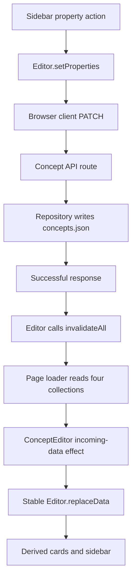

# 12. HTTP and persistence

A metadata edit starts in a browser component, crosses an HTTP boundary, and updates server-owned JSON. A successful request then triggers a loader refresh so the editor derives its views from canonical records again.

This chapter traces an existing property update and adds a temporary `reviewed` property button as an exercise. No schema, route, or client API is added. Implement and test the button only in an isolated disposable project copy, never against the live JSON store. Earlier display exercises are optional.

## Responsibilities and main functions

| File under `src/`                                     | Responsibility and main API                                                                                       |
| ----------------------------------------------------- | ----------------------------------------------------------------------------------------------------------------- |
| `lib/components/editor/sidebar/ConceptSidebar.svelte` | Handles input and calls the contextual editor.                                                                    |
| `lib/components/editor/Editor.svelte.ts`              | `setProperties` assigns the complete property object; `updateConcept` coordinates the client request and refresh. |
| `lib/client/concepts.ts`                              | `updateConceptRecord` sends a typed `PATCH /api/concepts` request.                                                |
| `routes/api/concepts/+server.ts`                      | `PATCH` selects the title or metadata path and constructs repository input.                                       |
| `lib/server/repositories/conceptRepository.ts`        | `updateConcept` finds the record, replaces supplied metadata fields, and saves the collection.                    |
| `routes/+page.server.ts`                              | `load` reads all four canonical collections.                                                                      |
| `lib/components/editor/ConceptEditor.svelte`          | Bridges incoming page data into the existing editor with `replaceData`.                                           |

`src/lib/server/conceptService.ts` coordinates operations such as creating a Concept with an instance and reassigning an instance after a title edit. Ordinary property/tag updates go directly from the Concept route to repository `updateConcept`; they do not pass through that service.

Browser components use Editor commands and browser clients, not server repositories. Repositories import Node file APIs and own filesystem paths; keeping them under the server boundary prevents browser code from acquiring disk-access responsibilities.

## A property update from input to disk

Suppose the sidebar changes `colour` to `'blue'` while retaining the Concept's other properties.

1. Local `updatePropertyValue` copies the existing property object and assigns the new value.
2. `Editor.setProperties(card, properties)` immediately assigns `card.concept.properties = properties`, then returns the result of `this.updateConcept(card.concept.id, { properties })`.
3. `Editor.updateConcept` calls `updateConceptRecord(id, updates)`.
4. The client sends JSON `{ id, properties }` to `PATCH /api/concepts`, with `Content-Type: application/json`.
5. The route requires a nonempty string ID. With no string `title`, it follows the metadata branch and constructs `UpdateConceptInput`.
6. Repository `updateConcept` reads all Concepts, finds the ID, replaces `concept.properties`, and calls `saveAllConcepts`. A missing Concept returns `null`, which the route maps to 404.
7. `saveAllConcepts` rewrites `src/lib/data/concepts.json` and the route returns the updated Concept.
8. The browser client returns the response, but `Editor.updateConcept` does not merge that returned object into every card. After success it awaits `invalidateAll()`.

The property object is a **complete replacement**, even though the HTTP method is PATCH. Sending `{ properties: { reviewed: 'yes' } }` would discard every other property. The caller must preserve entries it intends to retain.

## Reloading canonical records

Invalidation is the return path into the UI, not another write:



`+page.server.ts` reads Concepts, instances, relationships, and relationship definitions. `ConceptEditor.svelte` tracks the incoming collections and calls `editor.replaceData(...)` inside `untrack`. It does not construct a new editor for each refresh.

`replaceData` normalizes Concepts and instances, assigns relationships and definitions, and lets indexes, card views, and owner-derived values recalculate. Keeping the Editor object stable preserves its context identity and workspace state while replacing server records. It also retains a detached snapshot of the last loaded records for restoring optimistic edits if a save fails.

Camera persistence is a deliberate exception. `CanvasController.saveCurrentCanvasCamera` calls `updateConceptInstanceRecord` without invalidation while saving the outgoing owner instance. Do not apply that exception to ordinary metadata updates.

## Supporting helpers and actual guarantees

After following the command path, inspect these helpers:

- `getErrorMessage` in `src/lib/client/http.ts` reads JSON `error` or `message`, falling back to an HTTP-status message. `updateConceptRecord` throws on non-success responses.
- `getAllConcepts` reads and parses the complete file, then maps `normalizeConcept` over the records.
- `normalizeConcept` supplies defaults; it is not comprehensive runtime validation.
- `saveAllConcepts` serializes the complete array with two-space indentation and a trailing newline.

The repository path is resolved from `process.cwd()` to `src/lib/data/concepts.json`. The process working directory therefore matters: a disposable server must start from the disposable project's root.

Current limits are important when interpreting a successful UI update:

- The route checks that `properties` is a non-null, non-array object, then casts it to `Record<string, string>`. It does not validate each property's value as a string. TypeScript request types do not enforce runtime JSON shapes.
- For `tagConceptIds`, the route filters an array to strings; it does not check every referenced Concept exists. Editor-side deduplication/self-tag checks are not equivalent to server validation.
- If `body.title` is a string, the separate title/identity branch runs and requires an instance ID. This is not the ordinary metadata branch.
- `Editor.updateConcept` returns `true` after a successful write and refresh. On failure it logs the exception, restores the last-loaded record snapshot, sets `saveError`, and returns `false`. The workspace displays that message with a Reload button. Recovery makes no loader request, so it also works offline; the snapshot is not proof of the server's final state if a response was lost.
- Read/modify/write of a whole JSON file is not a transaction or concurrency-control mechanism. Concurrent writes can lose changes; the current design does not establish multi-user safety.

## Exercise: add a temporary “Mark reviewed” button

In the disposable copy's `src/lib/components/editor/sidebar/ConceptSidebar.svelte`, add a plain button beside the Properties heading. It must call the existing `editor.setProperties` with the current `sidebarCard`, all its existing properties, and `reviewed: 'yes'`.

Requirements:

1. Change only this component; add no CSS, model field, route, client function, or forwarding Editor method.
2. Preserve unrelated properties. `reviewed` is an ordinary string property, not an approved status enum or permanent workflow.
3. Use the existing current-owner branch so the button is absent at root.
4. Record the chosen Concept ID and whether `reviewed` already exists before testing. If it exists, retain its exact original value, including an empty string. Keep these details private.
5. Follow the backup and isolation procedure below before clicking anything. Do not test mutations against live files.

The [separate solution](solutions/12-http-and-persistence.md) supplies the markup. Neither the metadata summary nor the relationship count is required.

## Protect data and isolate execution

Use native WSL commands from the original project root. Stop the live application and other writers first. Create a fresh external backup directory outside the checkout:

```sh
mkdir ../concept-editor-tutorial-12-backup
```

If it already exists or creation fails, stop and choose a fresh location; do not overwrite an earlier backup. Copy all four related files, preserving the existing project-level archive:

```sh
cp -p src/lib/data/concepts.json ../concept-editor-tutorial-12-backup/
cp -p src/lib/data/concept_instances.json ../concept-editor-tutorial-12-backup/
cp -p src/lib/data/concept_relationships.json ../concept-editor-tutorial-12-backup/
cp -p src/lib/data/relationship_definitions.json ../concept-editor-tutorial-12-backup/
```

Verify each copy without printing personal records:

```sh
cmp src/lib/data/concepts.json ../concept-editor-tutorial-12-backup/concepts.json
cmp src/lib/data/concept_instances.json ../concept-editor-tutorial-12-backup/concept_instances.json
cmp src/lib/data/concept_relationships.json ../concept-editor-tutorial-12-backup/concept_relationships.json
cmp src/lib/data/relationship_definitions.json ../concept-editor-tutorial-12-backup/relationship_definitions.json
```

Every comparison must exit successfully. A backup is verified only after comparison, not merely because a copy command was issued. Keep it until the exercise is complete; it is separate from `data-backup-do-not-delete-project-level-data.zip`.

Create a separate local project copy, still with all writers stopped:

```sh
mkdir /tmp/concept-editor-tutorial-12
cp -a . /tmp/concept-editor-tutorial-12/workspace
```

Stop on either failure; do not merge into an existing directory. This copies the working tree, including local changes, dependencies if present, and private JSON. Keep the copy local; do not upload it or commit it as tutorial output. It can be large. `/tmp` is disposable storage, not the external backup.

Switch to the copy and verify its path before editing or launching:

```sh
cd /tmp/concept-editor-tutorial-12/workspace
pwd
realpath src/lib/data
```

Both outputs must identify the `/tmp/concept-editor-tutorial-12/workspace` copy. Its `src/lib/data` must be a real independent directory, not a symlink to the live store. If it is not, stop. Confirm copied data matches the protected baseline before testing.

Make the component change **in this copy**. Run the static checks there:

```sh
npm run check
npm run build
```

For the optional browser trace, launch from this same root on a distinct port:

```sh
npm run dev -- --host 127.0.0.1 --port 5174 --strictPort
```

Use the server URL on port 5174, not an old tab connected to the live application. No automated mutation test should target the live JSON store.

## Verify the write and refresh

On a Concept chosen in the disposable copy:

1. Record the original `reviewed` key state privately, then click **Mark reviewed** once.
2. Inspect the existing `PATCH /api/concepts` request: it must include the Concept ID and complete property object. Do not copy personal payloads into notes.
3. Confirm a successful response and subsequent page-data reload. Check the property list retains all other entries and shows `reviewed: yes`.
4. Reload the browser and confirm the value persists in the disposable store. This distinguishes a successful write from the immediate local assignment.
5. Click again: the property count must not increase again. If the key already existed, it must not increase at all.
6. If present, the metadata summary updates; the relationship count is unchanged. These are optional extra observations, not prerequisites.

Check that the original workspace's four data files still match its external backup if no intentional live edits occurred in the meantime. If they differ, investigate; do not automatically restore them over potentially desired changes.

## Cleanup without losing later work

Remove only the temporary button, preserving any other heading content or exercise changes. Removing code does not undo persisted data.

In the disposable copy, restore the tested Concept's `reviewed` field through the existing property UI: restore the exact original value if the key existed, or remove the key only if it was originally absent. Leave every other property and Concept unchanged. If `reviewed` itself has been intentionally edited since the test, do not overwrite that later value without deciding which change to retain.

Do not restore an entire JSON backup over unrelated later edits. No live-file restoration should be necessary because the exercise ran in isolated storage. Stop the disposable server when finished. Retain backups until verification is complete; never delete the project-level archive as cleanup.

## Summary

The component supplies a complete metadata value, the client transports it, the route selects and checks input, and the repository rewrites JSON. Invalidation reloads canonical records into the stable Editor. Immediate display, successful HTTP, and persistence after reload are different evidence; safe testing keeps all writes outside the live workspace.

- [Properties and tags](11-properties-and-tags.md)
- [Integration](13-integration.md)
- [Exercise solution](solutions/12-http-and-persistence.md)
