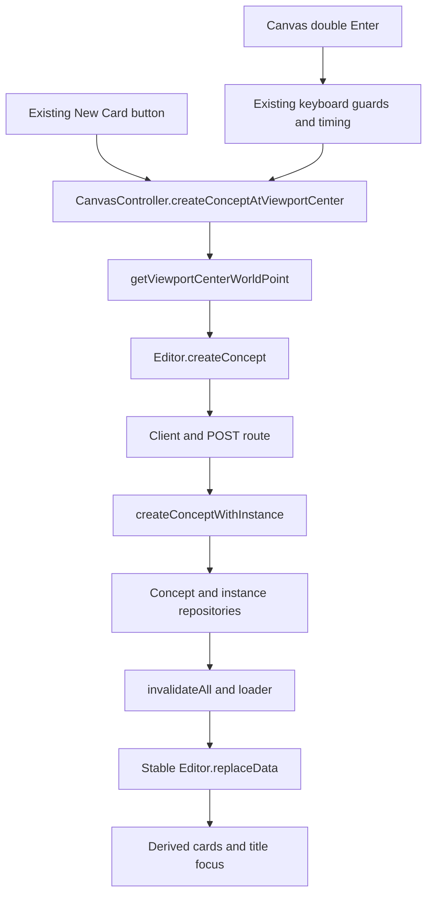

# 13. Integration

A command can serve several input paths without moving persistence into the UI. This chapter revises the New Card implementation from [creation and title editing](10-creation-and-title-editing.md): move `createConceptAtViewportCenter` from `Editor` to `CanvasController`, update the existing button, and reuse the command from canvas double Enter.

The user action stays the same. Only ownership and reuse change. The controller owns camera/viewport state; `Editor.createConcept` continues to own creation defaults, focus intent, and refresh.

## Required starting implementation

Complete the optional [New Card exercise](10-creation-and-title-editing.md#optional-exercise-add-a-new-card-button) before this exercise. If you removed it, reapply its [solution](solutions/10-creation-and-title-editing.md) first. Do not create another New Card button here.

Confirm the starting implementation contains:

- `Editor.createConceptAtViewportCenter()`, obtaining the position from `this.canvas.getViewportCenterWorldPoint()` and returning `this.createConcept({ position })`;
- one New Card button calling `editor.createConceptAtViewportCenter()`.

These are tutorial additions, not features present in the inspected application source. Reapplying source code does not require clicking the button or creating data. Other retained exercises are independent; this exercise does not require metadata summaries, relationship counts, ID display, or temporary persistence buttons. Remove any temporary mutation control from the HTTP exercise if it remains, without reverting unrelated work.

## Responsibilities and main functions

| File                                                                              | Responsibility in the revised path                                                                   |
| --------------------------------------------------------------------------------- | ---------------------------------------------------------------------------------------------------- |
| `src/lib/components/editor/canvas/CanvasTopbar.svelte`                            | Presents the existing New Card button and obtains the workspace Editor through `getEditorContext()`. |
| `src/lib/components/editor/canvas/CanvasController.svelte.ts`                     | Owns the revised `createConceptAtViewportCenter` command and `handleWindowKeydown`.                  |
| `src/lib/components/editor/Editor.svelte.ts`                                      | Keeps `createConcept` unchanged; loses the exercise's spatial wrapper.                               |
| `src/lib/client/concepts.ts`                                                      | `createConceptRecord` sends the existing creation request.                                           |
| `src/routes/api/concepts/+server.ts` and `src/lib/server/conceptService.ts`       | `POST` and `createConceptWithInstance` create linked Concept and instance records.                   |
| `src/lib/server/repositories/`                                                    | Persist complete JSON collections.                                                                   |
| `src/routes/+page.server.ts` and `src/lib/components/editor/ConceptEditor.svelte` | Reload canonical records and pass them into the stable Editor.                                       |

Read the main command and `handleWindowKeydown` before the supporting `getViewportCenterWorldPoint` helper. Then follow `Editor.createConcept` through HTTP and refresh. This order separates the operation's purpose from coordinate arithmetic and storage details.

## One spatial command, two callers

The target structure is:



The revised controller method will return the existing creation result:

```ts
async createConceptAtViewportCenter() {
	const position = this.getViewportCenterWorldPoint();
	return this.editor.createConcept({ position });
}
```

Returning the promise preserves completion/error propagation and the `{ concept, instance }` result. It does not introduce another invalidation or implement persistence in the controller.

The supporting helper reads the bound canvas rectangle and controller camera state:

```text
world x = (viewport width / 2 - panX) / zoom
world y = (viewport height / 2 - panY) / zoom
```

Keep this helper unchanged, including its `(0, 0)` fallback when the canvas element is unavailable. The resulting point is the instance's top-left anchor, not the card's geometric center. Collision avoidance and exact visual centering are outside this exercise.

## Preserve the keyboard boundaries

The current `handleWindowKeydown` does more than create a record. Before its creation block, it:

1. Handles Escape and Space separately.
2. Returns for keys other than `event.code === 'Enter'`.
3. Returns when `document.activeElement` is interactive, including title inputs and buttons.
4. Calls `consumeDoubleEnter` with `canvas:<owner instance ID or root>`.
5. Returns unless two Enter presses match that target within 450 ms.
6. Prevents default and stops propagation for the recognized double Enter.

Only replace the final center/position/create block. Do not move or remove the guards, timing call, or event handling.

There are separate creation paths that must remain separate:

| Input                    | Placement and behavior to preserve                                                                           |
| ------------------------ | ------------------------------------------------------------------------------------------------------------ |
| Canvas double Enter      | Use the revised viewport-center command.                                                                     |
| New Card button          | Use that same command; keep the arrow callback so the method retains its receiver.                           |
| Title-input double Enter | Await `commitTitleEdit`, then use `getNearbyCardPosition(card)` and `Editor.createConcept` to create nearby. |
| Canvas double-click      | Use pointer-to-world conversion plus the existing random offset.                                             |

The title handler's timing target is `title:<instance ID>`. Enter commits without blurring; blur commits too, and Escape restores the original title before blurring. The window handler excludes the focused input rather than treating this as canvas Enter.

A reported title conflict currently stores state and returns normally. The title-input double-Enter branch can therefore still create nearby after a conflict; it does not wait for a resolving chooser. This integration must not replace that branch with viewport-center creation or imply the missing chooser has been implemented.

## Concrete creation trace

Suppose the open canvas belongs to instance A. Its viewport is 1000 × 600 pixels, pan is `(100, -50)`, and zoom is `2`.

1. Clicking the retained button or recognizing canvas double Enter calls `CanvasController.createConceptAtViewportCenter()`.
2. The helper returns world point `(200, 175)`.
3. The controller calls `Editor.createConcept({ position: { x: 200, y: 175 } })`.
4. The Editor supplies medium dimensions, parent A, and default focus intent.
5. `createConceptRecord` sends `POST /api/concepts`.
6. The service creates a blank Concept with empty properties/tags and a new instance referring to it. The instance uses parent A and anchor `(200, 175)`.
7. Repositories save Concepts, then instances. These writes are sequential, not transactional.
8. The Editor sets `pendingFocusInstanceId` and `activeInstanceId`, then awaits `invalidateAll()`.
9. The loader rereads canonical records. `ConceptEditor.svelte` calls `replaceData()` on the existing Editor through its `untrack()` bridge.
10. Derived cards include the new occurrence beneath A. Its card effect focuses/selects the title input and clears pending focus.

At root, step 4 supplies `null` instead of A. Neither input path supplies its own parent, duplicates defaults, or pushes into a cards array.

## Exercise: move and share the command

Starting from the required chapter 10 implementation:

1. Add `CanvasController.createConceptAtViewportCenter()` immediately after `getViewportCenterWorldPoint()` in `src/lib/components/editor/canvas/CanvasController.svelte.ts`.
2. Use the method shown above: get the world point from `this`, then return `this.editor.createConcept({ position })`.
3. Change the existing New Card button in `src/lib/components/editor/canvas/CanvasTopbar.svelte` to call `editor.canvas.createConceptAtViewportCenter()` through an arrow callback.
4. Remove only the tutorial's `Editor.createConceptAtViewportCenter()` wrapper from `src/lib/components/editor/Editor.svelte.ts`.
5. In `handleWindowKeydown`, replace its final center/position/create block with `await this.createConceptAtViewportCenter()`.
6. Leave `Editor.createConcept`, `handleConceptTitleKeydown`, `handleConceptTitleBlur`, `consumeDoubleEnter`, and `handleCanvasDoubleClick` unchanged.

Add no route, client, service, repository, schema, component, prop, or CSS. Do not change title conflict policy, shared metadata, identity, or containment. The result must contain one New Card button and one definition of `createConceptAtViewportCenter`, on `CanvasController`.

[Exercise solution](solutions/13-integration.md)

## Safe backup and restore

Static editing/checks need no data mutation. Manual creation writes both Concept and instance collections; navigation, camera, and geometry operations may also write instances. Prefer disposable isolated storage. Do not run automated mutation tests against live JSON.

Before manual checks in this checkout, stop the app and all other writers. From `/home/cory/development/concept-editor` in native WSL Ubuntu, create a new external directory:

```sh
mkdir -m 700 /home/cory/concept-editor-tutorial-13-backup
```

Stop if the command fails or the directory exists. Choose another unused literal name and update every command consistently; never overwrite an uncertain earlier backup. Copy and verify both files:

```sh
cp -p src/lib/data/concepts.json /home/cory/concept-editor-tutorial-13-backup/concepts.json &&
cp -p src/lib/data/concept_instances.json /home/cory/concept-editor-tutorial-13-backup/concept_instances.json &&
cmp src/lib/data/concepts.json /home/cory/concept-editor-tutorial-13-backup/concepts.json &&
cmp src/lib/data/concept_instances.json /home/cory/concept-editor-tutorial-13-backup/concept_instances.json &&
printf 'Paired backup verified\n'
```

Continue only after all commands succeed and the message appears. Preserve `data-backup-do-not-delete-project-level-data.zip`. The pair covers this exercise, not relationship edits or unrelated storage changes.

After checks, restore only if the backup is the complete state you intend to preserve. **Never restore over desired later edits**, including metadata, titles, parentage, geometry, or camera changes. If those exist, preserve the current state separately and reconcile intentionally instead.

Stop the app and all writers before restoring the pair:

```sh
test -s /home/cory/concept-editor-tutorial-13-backup/concepts.json &&
test -s /home/cory/concept-editor-tutorial-13-backup/concept_instances.json &&
cp -p /home/cory/concept-editor-tutorial-13-backup/concepts.json src/lib/data/concepts.json &&
cp -p /home/cory/concept-editor-tutorial-13-backup/concept_instances.json src/lib/data/concept_instances.json &&
cmp src/lib/data/concepts.json /home/cory/concept-editor-tutorial-13-backup/concepts.json &&
cmp src/lib/data/concept_instances.json /home/cory/concept-editor-tutorial-13-backup/concept_instances.json &&
printf 'Paired restore verified\n'
```

Keep the app stopped if any step fails, until both files are restored and verified. Keep the external backup. Deleting a test instance is not exact rollback because its Concept remains; do not remove arbitrary IDs or regenerate data.

## Verification

Run static checks first:

```sh
npm run check
npm run build
```

Inspect the diff separately from those results:

- Only `CanvasController` defines `createConceptAtViewportCenter`.
- Both the retained button and canvas double Enter call it.
- Keyboard guards, target IDs, and the 450 ms timing window are unchanged.
- Title-input Enter/blur/Escape, nearby creation, and pointer-relative double-click are unchanged.
- `Editor.createConcept`, the persistence layers, and the loader-to-Editor bridge are unchanged.

With isolated data or the verified paired backup, optional manual checks are:

1. Pan/zoom root and click New Card. Confirm the visible-center anchor and title focus.
2. Move focus out of all interactive elements before pressing Enter twice; the newly created title input is focused by default. Confirm canvas double Enter uses the same anchor.
3. Repeat inside an occurrence. Confirm the exact owner instance ID becomes the parent, not its Concept ID.
4. Using a disposable blank card, press Enter twice in its title. Confirm nearby placement remains distinct from viewport-center creation. Do not edit a personal title to test this.
5. Double-click blank canvas and confirm pointer-relative placement still works.
6. Check browser requests/errors, then reload and confirm persistence.

A successful build does not establish those browser behaviors. Do not mark behavior checks complete without actually running them against protected/disposable data.

## Source cleanup

Source cleanup and data rollback are independent choices. Keep the integrated implementation if desired. Otherwise:

- To return to chapter 10's version, restore its Editor wrapper, point the existing button back to it, restore the original final double-Enter block, and remove the controller command.
- To remove the New Card exercise entirely, remove the button/controller command and restore the original final double-Enter block; do not reintroduce the Editor wrapper.

The [solution](solutions/13-integration.md#source-cleanup) includes the original block. Preserve other work and rerun static checks. Use the paired restore procedure only when its data-safety conditions hold.

## Summary

- `CanvasController.createConceptAtViewportCenter` owns spatial intent; `Editor.createConcept` keeps creation policy and refresh.
- The existing button and canvas double Enter share one command without duplicating persistence or defaults.
- Title-input double Enter and pointer double-click retain their distinct placements and handlers.
- The complete path still runs through HTTP, coordinated service writes, invalidation, stable Editor refresh, derived cards, and component-local focus.
- Documentation, static checks, and protected browser verification provide different kinds of evidence.
