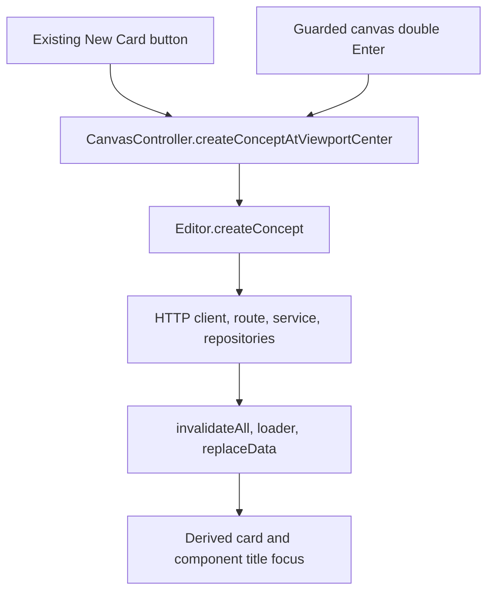

# 13. Integration — exercise solution

[Chapter](../13-integration.md) · [Required New Card implementation](../10-creation-and-title-editing.md#optional-exercise-add-a-new-card-button)

This solution revises the chapter 10 implementation. Before proceeding, confirm that `Editor.createConceptAtViewportCenter()` and its one New Card button exist. If removed or skipped, apply the [chapter 10 solution](10-creation-and-title-editing.md) first. Do not add a second button.

## Files changed by the exercise

- `src/lib/components/editor/canvas/CanvasController.svelte.ts`: add the spatial command and reuse it from canvas double Enter.
- `src/lib/components/editor/canvas/CanvasTopbar.svelte`: change the existing button's call target.
- `src/lib/components/editor/Editor.svelte.ts`: remove the chapter 10 wrapper, leaving `createConcept` unchanged.

No persistence-layer or model change is needed.

## Move the command to CanvasController

In `src/lib/components/editor/canvas/CanvasController.svelte.ts`, add this immediately after `getViewportCenterWorldPoint()`:

```ts
async createConceptAtViewportCenter() {
	const position = this.getViewportCenterWorldPoint();
	return this.editor.createConcept({ position });
}
```

Keep `getViewportCenterWorldPoint` unchanged. It converts viewport center using controller-owned pan/zoom and the bound canvas element. The new command returns the creation promise/result; it does not duplicate creation defaults or invalidation.

## Update the existing button

In `src/lib/components/editor/canvas/CanvasTopbar.svelte`, replace the chapter 10 button's call target:

```svelte
<button type="button" onclick={() => editor.canvas.createConceptAtViewportCenter()}>
	New Card
</button>
```

Keep the arrow callback and existing `getEditorContext()` lookup. There should still be exactly one New Card button.

## Remove the Editor wrapper

Delete only this chapter 10 method from `src/lib/components/editor/Editor.svelte.ts`:

```ts
async createConceptAtViewportCenter() {
	const position = this.canvas.getViewportCenterWorldPoint();
	return this.createConcept({ position });
}
```

Do not change `Editor.createConcept`. Its medium-size default, current-owner parent, pending/active focus IDs, browser client call, and invalidation remain the creation policy for every caller.

## Reuse the command from canvas double Enter

Inside `CanvasController.handleWindowKeydown`, replace only this final creation block:

```ts
const center = this.getViewportCenterWorldPoint();

const position = {
	x: center.x,
	y: center.y
};
await this.editor.createConcept({
	position
});
```

with:

```ts
await this.createConceptAtViewportCenter();
```

The Enter branch, including its existing guards, should now read:

```ts
if (event.code !== 'Enter') {
	return;
}

if (this.isInteractiveElement(document.activeElement)) {
	return;
}

const isDoubleEnter = this.consumeDoubleEnter(
	`canvas:${this.editor.currentCanvasOwnerInstanceId ?? 'root'}`
);

if (!isDoubleEnter) {
	return;
}

event.preventDefault();
event.stopPropagation();

await this.createConceptAtViewportCenter();
```

This is the Enter portion, not a replacement for the whole method. Keep the preceding Escape and Space handling intact. Do not change `consumeDoubleEnter` or its 450 ms window.

## Keep other input paths intact

Leave `handleConceptTitleKeydown` and `handleConceptTitleBlur` unchanged:

- Title Enter prevents default, records `title:<instance ID>`, and awaits `commitTitleEdit`.
- Title double Enter creates at `getNearbyCardPosition(card)`, not viewport center.
- A reported conflict returns normally from the commit, so the nearby creation branch can still run. This solution does not implement the missing chooser.
- Enter does not blur the title. Blur commits; Escape restores the canonical title and blurs.

Leave `handleCanvasDoubleClick` unchanged too. It uses pointer-to-world conversion plus the existing random offset, not the new command.

All service title semantics remain unchanged: case-insensitive matching, first-match reuse, the singly used blank-Concept naming exception, and otherwise a new Concept with copied properties/tags. Reassignment preserves instance identity, parentage, children, geometry, and camera.

## Resulting path



The controller supplies only `position`. At root the Editor supplies parent `null`; inside an occurrence it supplies the current owner instance ID. Placement uses the top-left anchor at the visible-center world point. The service still creates and saves a Concept followed by its linked instance; these writes are not a transaction.

The record arrays refresh inside the stable Editor. Do not recreate it, bypass the `untrack()` bridge, or push a fabricated card into component state.

## Verification and data safety

Run:

```sh
npm run check
npm run build
```

Inspect the diff for one controller definition, two callers, no Editor wrapper, unchanged keyboard guards, and unchanged title/pointer handlers. Static checks do not prove browser or persistence behavior.

Before any manual creation, use the chapter's exact [external backup and paired restore procedure](../13-integration.md#safe-backup-and-restore). Stop all writers, copy and verify both Concepts and instances, preserve the protected archive, and never restore over desired later edits. Keep the backup. Do not run mutation tests against live JSON.

Using disposable data or the verified backup:

1. Pan/zoom root and click New Card; confirm visible-center anchor and title focus.
2. Move focus out of interactive elements before pressing Enter twice. A newly created card focuses its title, so leaving focus there tests a different path.
3. Confirm canvas double Enter uses the same placement as the button.
4. Repeat in a nested canvas and confirm the exact owner instance ID becomes the parent.
5. On a disposable blank card, confirm title-input double Enter still creates nearby.
6. Confirm blank-canvas double-click remains pointer-relative.
7. Check browser requests/errors and reload persistence.

Do not create same-title conflicts in personal data to validate this ownership change. The instructions above are a verification plan, not a claim that browser testing has already passed.

## Source cleanup

Keep the integrated version if desired. To return to the chapter 10 implementation:

1. Re-add its Editor wrapper from the removal snippet above.
2. Point the existing button back to `editor.createConceptAtViewportCenter()`.
3. Replace `await this.createConceptAtViewportCenter()` in `handleWindowKeydown` with the original center/position/create block shown above.
4. Remove the controller's `createConceptAtViewportCenter()` method.

To remove the New Card exercise entirely, remove the button and controller method, restore the original double-Enter block, and do not re-add the Editor wrapper. Preserve unrelated work and rerun static checks.

Data rollback is separate from source cleanup. Restore both JSON files together only under the chapter's safety conditions. Deleting a test instance alone does not remove its Concept and is not exact rollback.

## Summary

One controller command now owns viewport-center creation for the existing button and canvas double Enter. Editor creation policy and the complete persistence/refresh path remain unchanged. Title-input creation stays nearby, and pointer-relative creation stays tied to the pointer.
